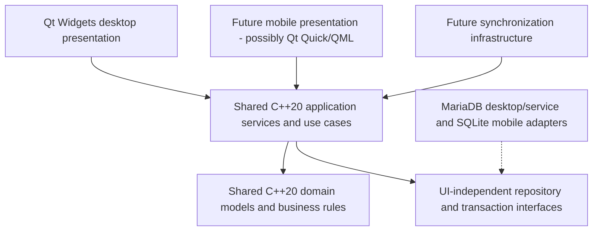
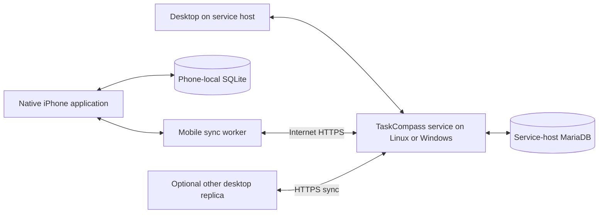

# Architecture proposal

Confirmed storage/platform direction: **MariaDB on Linux, Windows builds on a
Windows machine/VM, and a native iPhone app; Android is optional later.** Local
storage and eventual hosted storage must both remain possible. The phone must
connect over the internet to a TaskCompass service running on Linux or Windows,
and its local database must synchronize bidirectionally with the service database.

**Desktop decision: C++20 with Qt 6 Widgets**, developed with CMake and a
terminal/VIM workflow. Desktop is the primary target and will eventually provide
the complete feature set. Mobile has a separate presentation and may offer fewer
features; Qt Quick/QML is a provisional mobile option only. Exact dependency
versions, mobile framework, API implementation, and hosting provider remain open.

## Technology evaluation

These are engineering judgments for this project's scope, rather than claims that
one toolkit is universally preferable. The desktop decision is now settled; other
entries record alternatives considered, rather than reopening that choice.

| Candidate | Advantages here | Costs and risks | Assessment |
| --- | --- | --- | --- |
| Python + PySide6 / Qt Widgets | Concise domain/application code; built-in SQLite access; mature desktop trees, lists, dialogs, and model/view structure; terminal tooling. | Packaging native Qt dependencies; dynamic typing benefits from type hints; Python convention conflicts; mobile UI reuse requires separate evaluation. | Previously considered; superseded by the C++20/Qt Widgets desktop decision. |
| Java + JavaFX + MariaDB JDBC | Strong types; user preferences closely match Java naming and braces; explicit class/module boundaries; CLI build supported. | JDK/JavaFX/runtime packaging plus JDBC dependency; more ceremony; mobile reuse is not automatic. | Previously considered; superseded by the C++20/Qt Widgets desktop decision. |
| C++20 + Qt 6 Widgets + MariaDB desktop | Traditional menus, toolbars, trees, tables, splitters and dialogs fit the desktop product; C++ core can be reused independently of presentation. | C++ lifetime/build complexity and per-platform Qt SQL packaging. | Preferred desktop framework by architectural decision; validate on CentOS and Windows. |
| Shared C++ core + Qt Quick/QML mobile | Potential reuse of domain/application logic with a distinct touch-oriented UI. | QML bindings, ownership, iOS tooling/licensing and native integration need evaluation; UI reuse is not assumed. | Provisional mobile option; evaluate when mobile development begins. |
| Dart + Flutter + storage adapters | Potential desktop/mobile UI and logic reuse; language naming largely aligns. | New language and plugin/build ecosystem; CentOS not in Flutter's published Linux support matrix; formatter/file conventions differ. | Previously considered; shared UI is no longer the desktop/mobile goal. |
| TypeScript + Electron or Tauri + MariaDB desktop | Language overlap with checkbook; familiar web UI; potential contract/test reuse. | Electron bundles browser/runtime; Tauri adds Rust/native integration and Linux webview dependencies; neither automatically delivers a mobile client with the same runtime. | Previously considered; superseded by the traditional Qt Widgets desktop direction. |
| Browser/PWA like checkbook | Closest direct code reuse; installable mobile web UI. | Browser storage/lifecycle constraints and a different offline persistence model; less direct fit for requested compiled desktop and native iPhone targets. | Could complement hosted access; does not meet the confirmed native iPhone delivery on its own. |

Qt documents Widgets as its classic desktop UI toolkit and offers a separate Qt
Quick approach. See [Qt Widgets](https://doc.qt.io/qt-6/qtwidgets-index.html) and
[Qt for Python setup](https://doc.qt.io/qtforpython-6/gettingstarted.html).
JavaFX supports command-line Maven/Gradle workflows; an IDE is optional:
[JavaFX getting started](https://openjfx.io/openjfx-docs/).
Flutter publishes Linux support for Debian and Ubuntu, not CentOS Stream:
[Flutter supported platforms](https://docs.flutter.dev/reference/supported-platforms).

## Recommended application composition

Use **C++20 and Qt 6 Widgets** for the traditional desktop application. Plan menus,
toolbars and keyboard shortcuts; hierarchical pillar/project navigation; sortable,
filterable task tables/lists with manual ordering; splitter-based resizable panels;
and dialogs/editors for tasks, objectives, projects and planning. Guided quarterly,
sprint, weekly and daily planning workflows belong in the desktop feature set.
Sorting/filtering a view must remain separate from changing stored manual order.

### Organization and alternate desktop views

Use the confirmed single-parent organization in [DataModel.md](DataModel.md):
projects belong to one pillar/subpillar or project; objectives belong to one pillar/
subpillar or project and have no objective children. Tasks belong to one objective,
one direct project without an objective, or neither. Derive objective-task context
from its owner rather than storing conflicting task pillar/project links.

Provide three presentations of the same IDs/records:

- **Project-oriented:** pillars and nested subpillars, projects/subprojects under
  their owners, objectives under their owning pillar/project; access direct project
  tasks as well as objective tasks.
- **Objective-oriented:** objectives with their pillar/project paths and tasks.
  This is an alternate query/presentation, not new objectives or another ownership tree.
- **Sprint-oriented:** objectives selected through PeriodObjective and their tasks.
  Selection can reuse an objective across sprints without moving or copying it.

For example, TaskCompass → Complete desktop prototype remains the organizational
path whether November 2026, December 2026 or neither sprint selects the objective.
Removing a selection affects only that link; allocations and work history remain
separate. Reorganizing a parent changes current context, not task scheduling or
completion. No unfinished work rolls forward automatically.

The earlier many-to-many project/objective, task/objective and explicit pillar-link
proposals are superseded; no confirmed requirement requires retaining them. The
prototype uses only static path labels/filter tags to demonstrate navigation. This
does not create production relationship enforcement or a shared domain model.

The native iPhone application will have a separate UI and potentially reduced scope.
Candidate workflows are quick capture, today's scheduled tasks, completion, Worked
Today, Done for Today, and basic task review/editing, with offline operation and eventual sync.
These are candidates, not a finalized mobile feature list. The desktop need not
wait for mobile UI validation or be constrained to mobile navigation patterns.
Evaluate Qt Quick/QML later against native iOS requirements, licensing, build and
signing tooling, device behavior, and practical reuse of C++ application logic.
Android remains optional. No shared UI abstraction framework is planned.

Use a modular application with explicit SQL, focused persistence interfaces, and
transaction boundaries. Desktop MariaDB access can use Qt SQL's MariaDB-compatible
QMYSQL driver; mobile SQLite can use QSQLITE
([Qt SQL drivers](https://doc.qt.io/qt-6/sql-driver.html)). Verify driver availability, connector
libraries, redistribution requirements, and ABI compatibility per build target.
No ORM, dependency-injection framework, or local HTTP server is necessary for the
standalone desktop phase. Do not build adapters for hypothetical services now.

The presentation and infrastructure boundaries are separate from the deployment
topology below. Arrows in this first diagram show code dependencies, not sync flows.

Deployment topology (unchanged):

Domain models and rules live in a shared C++ library with no GUI, SQL, or networking
dependencies. Shared application services coordinate use cases such as captureTask,
scheduleWork, recordWork, completeTask and rescheduleAllocation through focused
repository/transaction interfaces. Both layers must build and be testable without
Qt Widgets, Qt Quick or QML. The desktop target needs no Qt Quick/QML runtime.
Domain rules never live in dialog handlers or QML.
Whether to allow a small Qt Core dependency or use only standard C++ value types
is an implementation decision; no presentation types may cross these boundaries.

Desktop controllers, item models, delegates and dialogs adapt results to Widgets.
A future mobile adapter can expose the same services through QObject properties,
signals and QML-facing models. These are presentation adapters, not shared domain
entities. Share use cases and rules rather than forcing both UIs into the same
screen structure or model roles. Views call use cases rather than writing rows;
repositories avoid one enormous generic database class. Transaction boundaries
keep completion, work history and allocation changes atomic. Inject clocks and ID
generation where deterministic behavior matters.

### Risks when sharing the C++ core

- Widgets tables/trees and mobile lists need different shapes, selection state and
  model roles. Keep those in separate adapters; share stable entity IDs and use-case
  results rather than widget pointers, QModelIndex values or QML objects.
- QObject ownership, QML object lifetimes and GUI-thread notifications differ from
  ordinary C++ value lifetimes. Define ownership at the adapter boundary and deliver
  asynchronous results safely; core operations must not depend on an open dialog
  or a particular GUI event loop. Qt supports C++ model exposure to QML, but that
  does not make the presentation models interchangeable
  ([Qt C++ models with Quick views](https://doc.qt.io/qt-6/qtquick-modelviewsdata-cppmodels.html)).
- Mobile suspension, reconnects and limited screens require resumable operations
  and a smaller UI. Preserve full domain data and validation even when some editing
  workflows are unavailable on mobile; do not weaken shared rules for a reduced UI.
- Separate MariaDB and SQLite adapters must honor the same use-case contracts and
  transaction semantics. Build targets should keep MariaDB libraries out of mobile
  and Widgets/QML libraries out of shared-core and headless-service targets.
- iOS toolchain/ABI compatibility, module licensing, signing and platform adapters
  (for example voice capture) need later device validation. Reusing C++ code does
  not eliminate those checks or settle the mobile framework.

Database access runs through a serialized worker with connections owned by their
thread; GUI updates return through signals. Future networking must not block the
UI thread. A local failure leaves the original state intact and produces a clear
error. Offline saves become authoritative on this device immediately; sync status
is separate from domain status.

Suggested *future* source boundaries: `domain/`, `application/`,
`infrastructure/storage/`, `infrastructure/sync/`, `desktop/`, future `mobile/`, `migrations/`,
and `tests/`. Phase 0.1 creates only desktop fixture/model/dialog code, an isolated
storage diagnostic and focused tests; no shared domain/application core is built.
VIM plus shell commands is the baseline workflow; build/run/test instructions must
not require editor extensions.

## Persistent command and undo architecture — introduced in Phase 1.1

Interaction policies are specified in [Interactions.md](Interactions.md). They are
production designs, not behaviors provided by the in-memory prototype. Keep command
requests/results, validation, inverse recipes and transaction interfaces in the
shared C++ application layer; presentation types never enter the business API.

Recommend a CommandService receiving typed intents such as createTask, editTask,
completeTask, reopenTask, recordWork, assignContext, reorderContexts, moveTask,
moveOrganization, rescheduleAllocation and selectPeriodObjective. Validate IDs,
expected revisions and touched invariants, then atomically commit domain rows,
CommandRecord/history, and dormant LocalChange records in MariaDB. An inverse is a
new compensating command against current revisions, never SQL rollback of a past
transaction or deletion of audit history. A failed command rolls back all its writes.

Receipts contain commandId, operationId, payload version, affected IDs, expected/
result revisions and the specific before/after values needed for inverse/redo.
Undo a create by tombstoning the created entity only if its current dependencies
permit it; undo field edits restores only touched fields with valid preconditions.
Completion receipts include lifecycle/timestamp/allocation changes. A cross-context
drop includes assignment, priority and rank changes (and any local rebalance) in
one receipt/transaction. Organizational moves validate both ancestry and related
row revisions; a dialog's stale snapshot is never authoritative.

Evaluate **QUndoStack as a desktop history adapter**, not as the transaction engine.
It provides labels, stack indexing and redo-branch handling, but push calls redo
immediately and undo/redo callbacks do not report database success. See
[Qt QUndoStack](https://doc.qt.io/qt-6/qundostack.html). Recommendation:

1. A desktop CommandController executes/awaits the shared service operation first.
   On success it pushes an already-applied receipt adapter; the push-triggered
   QUndoCommand::redo performs no second database mutation.
2. Route desktop Undo/Redo actions through that controller. It applies the inverse/
   forward intent via CommandService, awaits commit, then advances QUndoStack's
   index through bookkeeping-only callbacks. On failure, leave index and visible
   data unchanged and explain the failed precondition. Do not connect standard
   stack actions or arbitrary setIndex calls directly to persistence.
3. Serialize edits/undo while a commit is in flight, use revision preconditions,
   and refresh every view after commit. QUndoStack macros alone are not atomic
   database transactions. One dialog save or multi-property drag is one command;
   merely selecting, filtering or hovering is not a persistent command.

This adapter approach must have failure-injection tests in Phase 1.1. If it makes
stack bookkeeping fragile, use a small desktop history controller instead of
forcing persistence into QUndoCommand callbacks. Neither option changes shared
business APIs or requires a generic UI abstraction framework.

Recommend one chronological session stack per open dataset, shared across desktop
views, initially limited to 100 user commands (configurable later). Clear it on
close/restart/dataset change; persisted audit records are retained separately.
A new successful edit after undo drops only the in-memory redo branch. Failed or
cancelled edits do not discard redo. Redo is a new validated application of the
original intent with new operationId/revisions, same stable entity IDs and original
work-date intent; each retry of that *attempt* reuses its operationId. Store
compensatesCommandId/reappliesCommandId to relate durable history. Do not merge
already committed/synchronized audit entries as a typing optimization.

Cannot safely undo physical purge, destructive schema migration, backup restore,
or external side effects such as exported files via the ordinary stack. Require
separate recovery workflows. Reject stale inverses or creates with new dependents
rather than overwriting newer work. Restore/reopen commands may still be available
after session undo is gone, using current-state validation; audit retention does
not promise arbitrary long-term automatic rollback. Database autosave means the
stack's clean index is not an “unsaved data” indicator.

Future sync sends inverse/redo as normal new changes with tombstones/revisions.
Never rewind server receipts, cursors or acknowledged history. Conservative initial
policy: an externally applied sync/import change clears session undo/redo with a
notice; uncommitted/in-flight operations must finish or fail before applying it.
This avoids stale history replay. Later selective invalidation can retain unaffected
commands if proven safe; conflicting offline compensation remains reviewable under
the existing sync protocol. Local undo is not long-term distributed time travel.

Date/filter/order services use value inputs (clock, calendar zone, preferences,
FilterSpec, stable target IDs). Context ranks, task priority/manual ranks, and
PeriodObjective ranking are distinct state. Custom-field definitions/typed values
use repositories, not schema-per-field generation; details are in DataModel.md.
No command engine, undo stack or custom-field code is added in Phase 0.2.

## Approved daily ordering contract — 2026-11-11

User-defined context position is the primary grouping; unassigned tasks always
follow assigned contexts. One optional primary TaskContext assignment is approved
initially, with the logical link table retained for future secondary contexts.
Every new task defaults to numeric priority 5 (1 highest). Within each context,
compare ascending priority, hidden manual token, then stable task UUID. The hidden
manual value is never a visible subpriority editor and is independent of due dates,
planning-objective ranks and lifecycle.

Within a priority band, a drag changes only the hidden token. A cross-priority drop
adopts successor priority (predecessor at end, retain own priority for an empty
destination), previews it, and sets a destination token. A cross-context move also
sets/removes its context assignment. All touched values commit as one undoable
command; unrelated priorities and relative order are preserved, including during
any necessary local rank normalization. Cancellation writes nothing.

Variable-length fractional token representation remains recommended; comparison
is canonical case-sensitive unsigned-byte lexicographic across C++ and databases.
The exact encoding/generator, length threshold, normalization window and indexes
are implementation gates before Phase 1.3, not new user-interaction decisions.
Receipts include prior tuples and affected normalization keys for safe inverse/redo;
sync uses stable IDs/revisions/anchor checks rather than client clocks. Details:
[Interactions.md](Interactions.md) and [DataModel.md](DataModel.md). No production
ordering code is authorized by this validation task.

## Platform build and compatibility gates

- **Linux:** develop on CentOS Stream 9 using VIM, CMake and command-line tools.
  Validate C++20 compiler support, CMake/Qt 6 Widgets versions, MariaDB connector
  and QMYSQL plugin availability/compatibility on the actual host. Phase 0.1 now
  builds with GCC 11.5/CMake 3.31.8/Qt 6.10.3; QMYSQL loads with Connector/C 3.2.6.
  See [Building.md](Building.md) and [Roadmap.md](Roadmap.md) for actual results
  and pending live database/Windows validation.
- **Windows:** build and package on Windows or a Windows VM/runner, as explicitly
  accepted by the user. Test the same core with Windows Qt/connector binaries;
  document whether a local MariaDB service is installed separately. Linux-to-Windows
  cross-compilation is not a requirement.
- **iPhone (later):** evaluate the mobile framework for a native application with
  offline storage; Qt Quick/QML is provisional. Qt's iOS
  workflow requires Xcode tooling; plan access to a Mac or macOS build runner,
  device testing, signing, and provisioning. This is a build-environment constraint,
  not a change to Linux as the main development environment. See
  [Qt for iOS](https://doc.qt.io/qt-6.8/ios.html).
- **Android:** retain a portable core; defer Android SDK/NDK build and device checks
  until that platform is requested.

Use the release-specific [Qt platform matrix](https://doc.qt.io/qt-6.10/supported-platforms.html)
to select supported versions; it does not certify a CentOS binary or bundled SQL
plugin. The first technical prototype validates a Widgets main window with a
hierarchical tree, task table/list and task-editing dialog using temporary in-memory
fixtures. Include menus/toolbars/shortcuts and a splitter to check the traditional
layout. Verify the MariaDB driver can load and connect to a designated isolated test
instance without creating application tables. Build with CMake CLI on CentOS and
Windows. This does not implement task-management rules, migrations or sync.
Review Qt/module and connector distribution terms before selecting packages.
Mobile/Qt Quick validation comes later and is not a gate for this desktop prototype.

## Coding preferences and conflicts to discuss

Confirmed preferences: UPPER_CASE_SNAKE_CASE constants; camelCase variables and
functions; PascalCase classes and matching filenames; 3 spaces; same-line opening
braces. For multiline declarations/calls, put the first parameter after `(`, align
subsequent parameters, and put `)` on the final parameter's line.

For C++20/Qt Widgets, retain these preferences for project-owned code and do not
adopt a formatter that rewrites them. C++ does not require a conflicting naming or
brace convention. Framework-mandated override names and build-tool-reserved names
may require specific spellings; discuss any exception before introducing it.
If Qt Quick is chosen later, review its reserved spellings at that time; QML type
files can follow PascalCase and component IDs camelCase. No naming exceptions are
introduced by this documentation revision.

## Persistence and deployment modes

**MariaDB is the confirmed default Linux database**, following the checkbook's
pluggable persistence pattern. PostgreSQL is no longer the recommended default.
Keep TaskCompass's database, tables, migrations, and credentials separate from
checkbook data even if both use the same MariaDB server installation.

| Mode | Local storage | Network requirement / behavior |
| --- | --- | --- |
| Standalone Linux desktop | MariaDB service on the same computer; dedicated TaskCompass database | Works without internet while the local service is running. No online account/API required. |
| Standalone Windows desktop (proposed) | Local MariaDB service using the same repository contract | Windows build tested with MariaDB connector/plugin; service setup required. SQLite desktop alternative only if later requested. |
| Native iPhone, possible Android | Embedded SQLite replica, not a MariaDB server on the phone | Reads and edits offline; synchronizes when API connectivity returns. |
| Desktop hosting service and phone | MariaDB on Linux or Windows host, SQLite on phone | Phone synchronizes bidirectionally over internet HTTPS with the host service. Host desktop writes through the same validated service path. No third database required. |
| Additional desktop or hosted hub | Local MariaDB replica plus configured HTTPS API | Optional topology; local changes synchronize with the selected hub. Managed MariaDB may back the hub instead of host-local MariaDB. |
| Other hosted database service | Local stores unchanged; server-side persistence adapter | Evaluate the service's transactions, IDs, revisions, and API support before adding an adapter. Not every service is a drop-in replacement. |

A local MariaDB service is a local client/server database, rather than an embedded
single-file store. Offline means no external connectivity is needed; the local
service must still be running. Desktop saves must report a stopped/unavailable
local service clearly. Running only against a remote database would require
connectivity and would not satisfy the original offline requirement. Mobile and
connected desktop use local replicas plus synchronization instead.

Use a trusted local socket/loopback connection for standalone desktop MariaDB.
Future public clients use HTTPS to an application API; do not put hosted SQL
credentials into the phone or expose a database port as the mobile API. Endpoint
and server-side database configuration should support user-operated hosting or a
compatible managed service. Merely changing a SQL hostname does not supply offline
replication. Moving a standalone dataset to hosted storage requires an explicit
bootstrap/import and enrollment flow that preserves IDs and pending changes.

Use InnoDB transactions, bound parameters, foreign keys, and versioned migrations
for MariaDB. For SQLite mobile, enable foreign keys on each connection, serialize
writes, and evaluate WAL for same-device use. SQLite is appropriate embedded
storage ([SQLite use cases](https://www.sqlite.org/whentouse.html)); its enforcement
and journal behavior need explicit configuration
([foreign keys](https://www.sqlite.org/foreignkeys.html),
[WAL](https://www.sqlite.org/wal.html)). SQLite remains a proposed mobile mechanism,
not a replacement for the requested Linux MariaDB store.

Keep dialect-specific migrations/adapters and portable domain contracts. MariaDB
DDL may implicitly commit, so do not promise transactional rollback for every
schema change
([MariaDB implicit commits](https://mariadb.com/docs/server/reference/sql-statements/transactions/sql-statements-that-cause-an-implicit-commit)).
Use numbered/checksummed migrations, backup/restore, preflight
checks, and a documented recovery procedure; stop on unknown/newer schemas or
failure. Back up MariaDB with an appropriate consistent database backup process;
use SQLite's backup API or a quiesced database for mobile. Never file-sync live
MariaDB data directories or active SQLite files as a substitute for synchronization.

## Future synchronization proposal — do not implement yet

Recommend a shared HTTPS synchronization API backed by **MariaDB initially**, hosted
locally on the user's server or by a compatible service. Keep the server persistence
interface open to other providers; no PostgreSQL adapter or cloud SDK now. The API
language remains undecided: a small TypeScript service could follow checkbook
patterns, while a C++ service could reuse domain code. Evaluate that when service
work begins, with shared conformance tests for rules in either case.

### Linux/Windows service and bidirectional database synchronization

The service is an independently running TaskCompass process, separate from the GUI
and the MariaDB process. It must be deployable on either Linux or Windows and
continue serving the phone when the desktop GUI is closed. The host must be running
and reachable for synchronization; the phone keeps working from its own database
when it is not. Package service startup/configuration appropriately for each OS.

The simplest proposed connected topology uses the user's Linux or Windows computer
as the hub: its TaskCompass service owns the MariaDB write path, and the phone's
SQLite database is an offline replica. An additional cloud database is optional.
The desktop on that host uses the same service/application commands over loopback,
so its edits create revisions and change-log entries just like phone uploads.
When the host has no internet, local desktop use still works while its local
service and MariaDB are running. Standalone mode before sync can access MariaDB
directly; enabling service mode requires explicit adoption/bootstrap of existing
data and a single coordinated write path, not arbitrary direct SQL writes.

Synchronization is **two-way application-level data synchronization**: phone edits
flow to MariaDB, desktop/service edits flow to the phone, and accepted changes
converge after reconnection and conflict resolution. Different SQL engines do not
need identical physical schemas. Do not synchronize whole database files or rely
on MariaDB replication to synchronize SQLite. Tasks, associations, schedules, work
records, recurrence occurrences, and tombstones follow the shared protocol;
device-local metadata remains local as specified in DataModel.md.

Use authenticated HTTPS over the internet. Plan TLS termination, hostname,
reachability through firewall/router or a suitable private network/tunnel, and
protected credential storage at deployment time. The phone receives API credentials,
not MariaDB credentials. The implementation choice for networking/deployment remains
open; no network configuration is performed during this planning phase.

If a separate hosted hub is chosen later, the host desktop can instead maintain its
own MariaDB replica and synchronize through that hub's API. Initially choose one hub
per dataset; simultaneous independent Linux, Windows, and cloud hubs would require
an additional multi-server synchronization design and are not assumed by “Linux or
Windows service.” Keep the endpoint configurable so the user can choose hosting.

Use UUIDv4 IDs generated locally, retained forever across replicas. Reserve a
local datasetId from the start; bind it to a server account/dataset on enrollment.
Server authorization derives ownership from authenticated identity, never merely
from a supplied datasetId. TaskCompass and eEnvelopes remain separate datasets,
API namespaces, migrations, and domain models even if they later share hosting.

Proposed protocol behavior:

1. Every domain mutation commits with a durable local change record in the same
   local transaction (MariaDB desktop, SQLite mobile). Record entity/tombstone identity, immutable change payload,
   operationId, local revision, and base server revision. This is a transactional
   outbox, not full event sourcing. It can remain dormant until sync is built.
2. Push bounded batches with operation IDs. The server authenticates, validates
   domain rules and dataset scope, and compares expected revisions. In one server
   transaction, apply the accepted unit, store its deduplication receipt and payload
   digest, and append its change-log entries. Retrying the same ID/payload returns
   the same result; reusing the ID with another payload fails.
3. Server revisions are server-issued counters, not client timestamps. Independent
   rows may be accepted separately; one logical multi-row operation must be atomic.
   Conflicting updates to the same row fail for review; arbitrary fields are not
   automatically merged in the first protocol. Deduplicated work-entry IDs can merge
   independent entries, but competing completion/reopen commands need validation.
4. Pull ordered, paginated changes using an opaque server cursor. Apply a page and
   advance its cursor in one local transaction. Do not emit outbound changes for
   downloaded writes. Preserve pending local versions; retain server snapshots for
   conflicts rather than overwriting unsent edits. Handle parent/link ordering as
   transaction units and revalidate cross-row invariants on the server.
   Cursor ordering must follow committed visibility: a transaction still in flight
   must never commit behind a cursor already issued to clients. A raw database
   sequence alone is insufficient unless the publication protocol guarantees this.
5. Acknowledgment marks only the exact uploaded local revision as accepted. Edits
   made during upload remain queued. Serialize dependent operations on a record;
   rebase a later unsent edit onto the acknowledged revision without altering any
   payload already sent under an operationId. Lost responses must be safely retried.
6. Represent deletions with tombstones, including association removals. Concurrent
   delete/edit becomes an explicit conflict. Do not resurrect deleted parents or
   erase pending work silently. Purge only after device acknowledgment/retention
   policy permits; devices older than retained history must rebootstrap, preserving
   local pending work for reconciliation. Unlimited offline time and finite history
   retention cannot both guarantee incremental sync.
7. Expose pending/rejected/conflicting status and a review flow. Pause authentication
   failures, retry transient failures with bounded exponential backoff/jitter, and
   keep permanent validation failures visible. Conflict resolution creates a new
   operation against the latest revision. Never use client wall-clock last-write-wins.

Before service implementation, specify cursor expiry, bootstrap snapshots, protocol
versions, schema compatibility, deduplication retention, multi-device enrollment,
restore-to-new-device behavior, and auth/logout handling. A restored backup must
not reuse an active device identity or confuse operation receipts. Test lost replies,
crashes before/after commit, clock skew, duplicate pushes, tombstones, stale clients,
simultaneous ordering edits, and recurrence duplicates.

A small reusable protocol specification plus conformance fixtures is the first
shared artifact with the checkbook. Do not extract a generic sync framework until
both applications demonstrate the same needs. Authentication, TLS deployment,
backups, local sensitive-data protection, and server retention need concrete design
at that phase; no cloud provider or public multi-user service is assumed.

## Project license and distribution

Project-owned work is licensed **GPL-3.0-or-later**; see [LICENSE](../LICENSE) and
[Licensing.md](Licensing.md). No current desktop dependency blocker was identified.
Qt/connector/transitive notices and corresponding-source obligations still apply.
Future iOS signing/store terms and library replacement rights require a separate
release review; native iPhone distribution is not licensed/validated by this
architecture proposal. A commercial Qt license alone does not remove the project's
GPL obligations. No alternate license or linking exception is granted here.

## Phase 1.1 implementation checkpoint — 2026-11-12

Owner approved Step B source implementation. The original prototype remains
unchanged; a separate TaskCompass desktop preserves its traditional layout without
fixture organizational ownership. TaskCore uses standard C++ only. TaskStorage
implements Qt SQL transactions, strict UTF-8/UTC sessions and explicit migration
verification. PersistentDesktop invokes the command service on a serialized worker
and refreshes after commit. No GUI migration or account provisioning occurs.

A small TaskService history controller replaces the optional QUndoStack adapter.
Command receipts and dormant LocalChange rows commit with Task. Undo/redo are new
compensating writes; revisions/updatedAt advance while prior business values are
restored. Session history is capped at 100 and clears on restart. An uncertain
commit clears desktop history and requires reload/inspection, without blind retry.
Known failures leave the history index unchanged. Runtime credentials append audit
and change rows and cannot update/delete them. This is not a sync implementation.

The schema tool embeds the reviewed migration resource, uses checksums and a
stored normalized SHOW CREATE TABLE fingerprint, and rejects partial/newer/changed
schemas. Fingerprints are conservative: server-version formatting changes may
require operator review even without a semantic schema change. No automatic
fingerprint repair is allowed. Detailed decisions, limitations, SQL approval gates
and actual validation: [Phase 1.1](milestones/Phase1.1.md).
