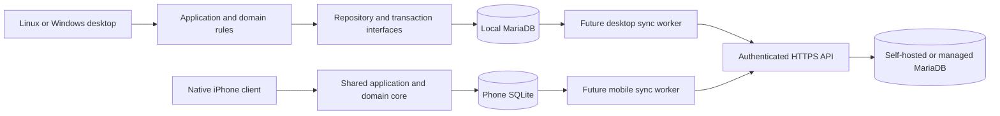

# Architecture proposal

Confirmed storage/platform direction: **MariaDB on Linux, Windows builds on a
Windows machine/VM, and a native iPhone app; Android is optional later.** Local
storage and eventual hosted storage must both remain possible. Toolkit, exact
versions, API implementation, and hosting provider remain proposals.

## Technology evaluation

These are engineering judgments for this project's scope, rather than claims that
one toolkit is universally preferable.

| Candidate | Advantages here | Costs and risks | Assessment |
| --- | --- | --- | --- |
| Python + PySide6 / Qt Widgets | Concise domain/application code; built-in SQLite access; mature desktop trees, lists, dialogs, and model/view structure; terminal tooling. | Packaging native Qt dependencies; dynamic typing benefits from type hints; Python convention conflicts; mobile UI reuse requires separate evaluation. | Viable desktop option, but a separate native mobile implementation would be the conservative plan. |
| Java + JavaFX + MariaDB JDBC | Strong types; user preferences closely match Java naming and braces; explicit class/module boundaries; CLI build supported. | JDK/JavaFX/runtime packaging plus JDBC dependency; more ceremony; mobile reuse is not automatic. | Best alternative if Java preference or Python syntax tradeoffs outweigh development speed. No Spring needed. |
| C++ + Qt Quick + MariaDB desktop / SQLite mobile | Native integration; Qt can serve desktop/mobile; requested braces/naming fit well. | More memory/lifetime/build complexity for one developer; Qt Quick introduces a second UI language. | Revised leading proposal for shared desktop/native-mobile core; validate Qt Quick desktop usability and packaging first. |
| Dart + Flutter + storage adapters | Potential desktop/mobile UI and logic reuse; language naming largely aligns. | New language and plugin/build ecosystem; CentOS not in Flutter's published Linux support matrix; formatter/file conventions differ. | Strong shared-UI alternative; validate CentOS and a desktop MariaDB bridge before selection. |
| TypeScript + Electron or Tauri + MariaDB desktop | Language overlap with checkbook; familiar web UI; potential contract/test reuse. | Electron bundles browser/runtime; Tauri adds Rust/native integration and Linux webview dependencies; neither automatically delivers a mobile client with the same runtime. | Viable with strong web preference, adds machinery for current desktop scope. |
| Browser/PWA like checkbook | Closest direct code reuse; installable mobile web UI. | Browser storage/lifecycle constraints and a different offline persistence model; less direct fit for requested compiled desktop and native iPhone targets. | Could complement hosted access; does not meet the confirmed native iPhone delivery on its own. |

Qt documents Widgets as its classic desktop UI toolkit and offers a separate Qt
Quick approach. See [Qt Widgets](https://doc.qt.io/qt-6/qtwidgets-index.html) and
[Qt for Python setup](https://doc.qt.io/qtforpython-6/gettingstarted.html).
JavaFX supports command-line Maven/Gradle workflows; an IDE is optional:
[JavaFX getting started](https://openjfx.io/openjfx-docs/).
Flutter publishes Linux support for Debian and Ubuntu, not CentOS Stream:
[Flutter supported platforms](https://docs.flutter.dev/reference/supported-platforms).

## Recommended application composition

The expanded platform requirements change the earlier desktop-only recommendation.
Propose **C++ with Qt 6 and Qt Quick/QML**, using an adaptive desktop/mobile UI and
shared domain/application code. This avoids relying on Python packaging as the
foundation for a native iPhone product and fits the requested C++ naming/braces.
C++ build/lifetime complexity and QML are real costs; Python/PySide6 plus a separate
native mobile client remains a reasonable simpler-desktop alternative. Flutter is
another shared-client option, subject to CentOS and MariaDB integration checks.
None is selected for implementation yet.

Use a modular application with explicit SQL, focused persistence interfaces, and
transaction boundaries. Desktop MariaDB access can use Qt SQL's MariaDB-compatible
QMYSQL driver; mobile SQLite can use QSQLITE
([Qt SQL drivers](https://doc.qt.io/qt-6/sql-driver.html)). Verify driver availability, connector
libraries, redistribution requirements, and ABI compatibility per build target.
No ORM, dependency-injection framework, or local HTTP server is necessary for the
standalone desktop phase. Do not build adapters for hypothetical services now.

Domain code has no GUI, SQL, or networking dependencies. Application operations coordinate
rules and transactions: captureTask, scheduleWork, recordWork, completeTask, and
rescheduleAllocation. Views call operations rather than writing rows. Repositories
express focused task/planning queries; avoid one enormous generic database class.
Shared transaction boundaries ensure completion, work history, and allocation
changes commit together. Inject clocks and ID generation where deterministic
behavior matters. Qt models expose application results to QML through signals/properties; avoid a second copy
of domain state in widgets.

Database access runs through a serialized worker with connections owned by their
thread; GUI updates return through signals. Future networking must not block the
UI thread. A local failure leaves the original state intact and produces a clear
error. Offline saves become authoritative on this device immediately; sync status
is separate from domain status.

Suggested *future* source boundaries: `domain/`, `application/`,
`infrastructure/storage/`, `infrastructure/sync/`, `desktop/`, `migrations/`,
and `tests/`. These folders are not created until implementation needs them.
VIM plus shell commands is the baseline workflow; build/run/test instructions must
not require editor extensions.

## Platform build and compatibility gates

- **Linux:** develop on CentOS Stream 9 using VIM, CMake and command-line tools.
  Validate supported compiler/CMake/Qt versions, QML graphics, MariaDB connector
  and QMYSQL plugin packaging on the actual host. No toolchain has been installed.
- **Windows:** build and package on Windows or a Windows VM/runner, as explicitly
  accepted by the user. Test the same core with Windows Qt/connector binaries;
  document whether a local MariaDB service is installed separately. Linux-to-Windows
  cross-compilation is not a requirement.
- **iPhone:** produce a native compiled application with offline storage. Qt's iOS
  workflow requires Xcode tooling; plan access to a Mac or macOS build runner,
  device testing, signing, and provisioning. This is a build-environment constraint,
  not a change to Linux as the main development environment. See
  [Qt for iOS](https://doc.qt.io/qt-6.8/ios.html).
- **Android:** retain a portable core; defer Android SDK/NDK build and device checks
  until that platform is requested.

Use the release-specific [Qt platform matrix](https://doc.qt.io/qt-6.10/supported-platforms.html)
to select supported versions; it does not certify a CentOS binary or bundled SQL
plugin. Prototype a tree/list/dialog workflow and responsive mobile view before
freezing the toolkit. Qt Widgets remains a desktop alternative, but would imply
separate mobile presentation. Review Qt/module and connector distribution terms
when selecting packages.

If Python remains preferred, its host Python 3.9 is below current PySide setup's
Python 3.10+ requirement; use a separate supported runtime, not a system replacement
([PySide setup](https://doc.qt.io/qtforpython-6/gettingstarted.html)). Packaging a
Windows Python app with PyInstaller runs on Windows; it is not cross-compilation
([PyInstaller documentation](https://pyinstaller.org/en/stable/)).

## Coding preferences and conflicts to discuss

Confirmed preferences: UPPER_CASE_SNAKE_CASE constants; camelCase variables and
functions; PascalCase classes and matching filenames; 3 spaces; same-line opening
braces. For multiline declarations/calls, put the first parameter after `(`, align
subsequent parameters, and put `)` on the final parameter's line.

For the C++/QML proposal, retain the requested 3-space indentation, names, brace
placement, and aligned multiline parameters. Keep framework-mandated API overrides
and QML-reserved spellings intact; discuss any naming exception before code is
introduced. QML type files can follow PascalCase; component IDs use camelCase.

If the Python alternative is selected, Python's usual function/variable/module naming and 4-space indentation differ
from these preferences ([PEP 8](https://peps.python.org/pep-0008/)). The proposal for that alternative
is to retain the user's camelCase, PascalCase class files, and 3-space indentation
for project-owned Python code; do not enable a formatter that rewrites them.
Python uses colons and indentation for blocks, so the requested brace style cannot
apply to Python control flow. This syntax tradeoff needs agreement before choosing
Python. Mandatory special methods such as `__init__` and external override/API names
must preserve required spelling; propose these narrow exceptions for review, not
as permission to adopt snake_case throughout. Qt APIs already commonly use camelCase.
Package/build-tool reserved names may also require specific spelling.

Java fits the requested naming/braces more directly. Dart conventionally uses
lowercase_with_underscores filenames; C++ framework overrides also keep prescribed
names. Discuss any such exceptions if selecting an alternative. No implementation
exceptions are introduced in this documentation-only iteration.

## Persistence and deployment modes

**MariaDB is the confirmed default Linux database**, following the checkbook's
pluggable persistence pattern. PostgreSQL is no longer the recommended default.
Keep TaskCompass's database, tables, migrations, and credentials separate from
checkbook data even if both use the same MariaDB server installation.

| Mode | Local storage | Network requirement / behavior |
| --- | --- | --- |
| Standalone Linux desktop | MariaDB service on the same computer; dedicated TaskCompass database | Works without internet while the local service is running. No online account/API required. |
| Standalone Windows desktop (proposed) | Local MariaDB service using the same repository contract | Windows build tested with MariaDB connector/plugin; service setup required. SQLite desktop alternative only if later requested. |
| Native iPhone, possible Android | Embedded SQLite replica, not a MariaDB server on the phone | Reads and edits offline; synchronizes when API connectivity returns. |
| Connected desktop and phone | Respective local stores plus configured HTTPS API | API uses self-hosted or managed MariaDB; queued edits survive network failure. |
| Other hosted database service | Local stores unchanged; server-side persistence adapter | Evaluate the service's transactions, IDs, revisions, and API support before adding an adapter. Not every service is a drop-in replacement. |

A local MariaDB service is a local client/server database, rather than an embedded
single-file store. Offline means no external connectivity is needed; the local
service must still be running. Desktop saves must report a stopped/unavailable
local service clearly. Running only against a remote database would require
connectivity and would not satisfy the original offline requirement. Mobile and
connected desktop use local replicas plus synchronization instead.

Use a trusted local socket/loopback connection for standalone desktop MariaDB.
Future public clients use HTTPS to an application API; do not put hosted SQL
credentials into the phone or expose a database port as the mobile API. Endpoint
and server-side database configuration should support user-operated hosting or a
compatible managed service. Merely changing a SQL hostname does not supply offline
replication. Moving a standalone dataset to hosted storage requires an explicit
bootstrap/import and enrollment flow that preserves IDs and pending changes.

Use InnoDB transactions, bound parameters, foreign keys, and versioned migrations
for MariaDB. For SQLite mobile, enable foreign keys on each connection, serialize
writes, and evaluate WAL for same-device use. SQLite is appropriate embedded
storage ([SQLite use cases](https://www.sqlite.org/whentouse.html)); its enforcement
and journal behavior need explicit configuration
([foreign keys](https://www.sqlite.org/foreignkeys.html),
[WAL](https://www.sqlite.org/wal.html)). SQLite remains a proposed mobile mechanism,
not a replacement for the requested Linux MariaDB store.

Keep dialect-specific migrations/adapters and portable domain contracts. MariaDB
DDL may implicitly commit, so do not promise transactional rollback for every
schema change
([MariaDB implicit commits](https://mariadb.com/docs/server/reference/sql-statements/transactions/sql-statements-that-cause-an-implicit-commit)).
Use numbered/checksummed migrations, backup/restore, preflight
checks, and a documented recovery procedure; stop on unknown/newer schemas or
failure. Back up MariaDB with an appropriate consistent database backup process;
use SQLite's backup API or a quiesced database for mobile. Never file-sync live
MariaDB data directories or active SQLite files as a substitute for synchronization.

## Future synchronization proposal — do not implement yet

Recommend a shared HTTPS synchronization API backed by **MariaDB initially**, hosted
locally on the user's server or by a compatible service. Keep the server persistence
interface open to other providers; no PostgreSQL adapter or cloud SDK now. The API
language remains undecided: a small TypeScript service could follow checkbook
patterns, while a C++ service could reuse domain code. Evaluate that when service
work begins, with shared conformance tests for rules in either case.

Standalone desktop may access its own local MariaDB directly. Remote/mobile
clients access central storage only through the API. Local and central stores are
separate replicas when synchronization is enabled; avoid simultaneously treating
the same schema as both replica and sync hub without a designed server write path.

Use UUIDv4 IDs generated locally, retained forever across replicas. Reserve a
local datasetId from the start; bind it to a server account/dataset on enrollment.
Server authorization derives ownership from authenticated identity, never merely
from a supplied datasetId. TaskCompass and eEnvelopes remain separate datasets,
API namespaces, migrations, and domain models even if they later share hosting.

Proposed protocol behavior:

1. Every domain mutation commits with a durable local change record in the same
   local transaction (MariaDB desktop, SQLite mobile). Record entity/tombstone identity, immutable change payload,
   operationId, local revision, and base server revision. This is a transactional
   outbox, not full event sourcing. It can remain dormant until sync is built.
2. Push bounded batches with operation IDs. The server authenticates, validates
   domain rules and dataset scope, and compares expected revisions. In one server
   transaction, apply the accepted unit, store its deduplication receipt and payload
   digest, and append its change-log entries. Retrying the same ID/payload returns
   the same result; reusing the ID with another payload fails.
3. Server revisions are server-issued counters, not client timestamps. Independent
   rows may be accepted separately; one logical multi-row operation must be atomic.
   Conflicting updates to the same row fail for review; arbitrary fields are not
   automatically merged in the first protocol. Deduplicated work-entry IDs can merge
   independent entries, but competing completion/reopen commands need validation.
4. Pull ordered, paginated changes using an opaque server cursor. Apply a page and
   advance its cursor in one local transaction. Do not emit outbound changes for
   downloaded writes. Preserve pending local versions; retain server snapshots for
   conflicts rather than overwriting unsent edits. Handle parent/link ordering as
   transaction units and revalidate cross-row invariants on the server.
   Cursor ordering must follow committed visibility: a transaction still in flight
   must never commit behind a cursor already issued to clients. A raw database
   sequence alone is insufficient unless the publication protocol guarantees this.
5. Acknowledgment marks only the exact uploaded local revision as accepted. Edits
   made during upload remain queued. Serialize dependent operations on a record;
   rebase a later unsent edit onto the acknowledged revision without altering any
   payload already sent under an operationId. Lost responses must be safely retried.
6. Represent deletions with tombstones, including association removals. Concurrent
   delete/edit becomes an explicit conflict. Do not resurrect deleted parents or
   erase pending work silently. Purge only after device acknowledgment/retention
   policy permits; devices older than retained history must rebootstrap, preserving
   local pending work for reconciliation. Unlimited offline time and finite history
   retention cannot both guarantee incremental sync.
7. Expose pending/rejected/conflicting status and a review flow. Pause authentication
   failures, retry transient failures with bounded exponential backoff/jitter, and
   keep permanent validation failures visible. Conflict resolution creates a new
   operation against the latest revision. Never use client wall-clock last-write-wins.

Before service implementation, specify cursor expiry, bootstrap snapshots, protocol
versions, schema compatibility, deduplication retention, multi-device enrollment,
restore-to-new-device behavior, and auth/logout handling. A restored backup must
not reuse an active device identity or confuse operation receipts. Test lost replies,
crashes before/after commit, clock skew, duplicate pushes, tombstones, stale clients,
simultaneous ordering edits, and recurrence duplicates.

A small reusable protocol specification plus conformance fixtures is the first
shared artifact with the checkbook. Do not extract a generic sync framework until
both applications demonstrate the same needs. Authentication, TLS deployment,
backups, local sensitive-data protection, and server retention need concrete design
at that phase; no cloud provider or public multi-user service is assumed.
