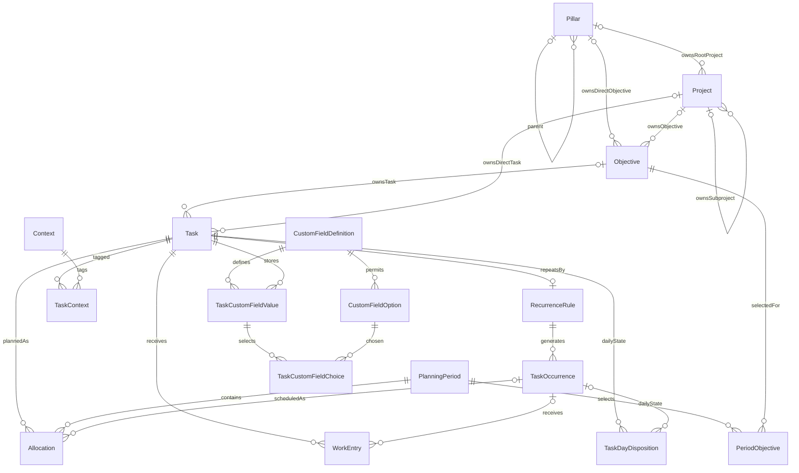

# Preliminary relational model

**Logical schema only; no executable DDL.** Organizational cardinalities are
confirmed; physical representation and other proposed columns/states remain for
review. This is not an instruction to create tables or migrations. Table names use
PascalCase and column names camelCase; no SQL snake_case exception is assumed.

## Domain relationships

Projects and objectives each have exactly one organizational parent. Projects
belong to a pillar (including a subpillar) or a parent project; objectives belong
to a pillar or project and cannot contain objectives. Tasks have either one
objective, one direct project, or no organizational parent. The optional diagram
edges are alternatives constrained by the parent rules below, not permission to
choose both parents. Sprint selection is a separate many-to-many relationship
through PeriodObjective; a sprint is a PlanningPeriod with horizon=sprint.

## Shared conventions

- Every domain table, including link tables, has a stable `id` UUID and `datasetId`.
  UUIDv4 is proposed. Link IDs allow their removals to be synchronized as tombstones.
- Unless listed as local-only, rows have `createdAt`, `updatedAt` (UTC instants),
  `deletedAt` (nullable UTC tombstone), and `localRevision` (local counter). Reserve
  nullable `serverRevision` for later sync; timestamps are audit data, not conflict order.
- UUIDs are proposed canonical CHAR(36) in MariaDB and text in mobile SQLite. Domain
  dates use ISO `YYYY-MM-DD`; UTC instants use a fixed canonical representation.
  Store named IANA time zones where calendar semantics require them. Booleans and
  controlled string values receive explicit constraints; do not depend on SQL enums.
- Every foreign key must target the same dataset, preferably using composite
  `(datasetId, referencedId)` foreign keys to unique `(datasetId, id)` targets.
  Logical uniqueness applies to live rows; tombstone restoration rules must be
  explicit. Proposed nullable fields are identified with `?` below.
- Prefer archive for historical entities. Soft deletion preserves history; no
  cascading physical deletion of work, allocations, or relationships during sync.
  Tombstone dependent links in the same logical delete operation. Physical purge
  is a later policy, not a UI delete behavior.

## Organization and task tables

Shared columns above are omitted from this table.

| Table | Proposed additional columns | Relationships / constraints |
| --- | --- | --- |
| Dataset | name, timeZone | Local dataset root, available without login; later mapped to authenticated server ownership. |
| Pillar | parentPillarId?, name, description, archivedAt? | Self FK; reject self-parenting and cycles; no arbitrary depth cap. |
| Objective | pillarId?, projectId?, title, description, lifecycleStatus, targetStartDate?, targetEndDate?, completedAt?, archivedAt? | Proposed active/onHold/completed/cancelled; date range valid when provided. Exactly one of pillarId/projectId; flat, with no parent-objective reference. No period ownership. |
| Project | pillarId?, parentProjectId?, title, description, lifecycleStatus, archivedAt? | Exactly one of pillarId/parentProjectId; acyclic parent chain terminating at a pillar; may be long-running. Project completion rules independent of child completion pending review. |
| Task | objectiveId?, directProjectId?, title, notes, taskKind, lifecycleStatus, triageStatus, planningVisibility, dueDate?, estimatedMinutes?, priority, manualOrderKey, completedAt?, archivedAt?, captureSource?, captureReference? | kind oneTime/continuing/recurring; proposed lifecycle active/onHold/completed/cancelled; triage inbox/organized; visibility normal/someday; estimate nonnegative; priority positive integer (proposed default 5); manual key independent of due date. At most one of objectiveId/directProjectId; both null allowed. No stored pillarId or derived projectId. Source metadata optional, provider-neutral. |
| Context | name, description, sortKey, archivedAt? | Entirely user-defined; persistent fractional order, stable UUID ties. Name case/uniqueness policy remains to be reviewed. |
| TaskContext | taskId, contextId, isPrimary | Recommended initial at most one live row per task, isPrimary=true; optional assignment. Unique live pair; future multiple live rows must retain exactly one primary. No organizational ownership meaning. |
| TaskDependency | predecessorTaskId, successorTaskId, dependencyKind | Unique live directed pair/kind; proposed kind finishToStart; reject self-links and directed cycles. |
| TaskRelation | firstTaskId, secondTaskId, relationKind | Non-blocking related links; canonical endpoint order for symmetric kinds; no self-links. |

### Valid parent combinations and context derivation

Propose separate, typed nullable foreign keys rather than a generic parentType/id
pair: they are few and allow database foreign keys plus simple row CHECK constraints.
The following rules are required regardless of the eventual physical representation:

| Entity | Valid identifier combinations | Invalid combinations |
| --- | --- | --- |
| Pillar | parentPillarId null (root), or one existing parent pillar | Self-parenting or cycles |
| Project | pillarId set and parentProjectId null; **or** pillarId null and parentProjectId set | Both set; both null; project ancestry cycles |
| Objective | pillarId set and projectId null; **or** pillarId null and projectId set | Both set; both null; any objective-as-parent relationship |
| Task | objectiveId set and directProjectId null; **or** objectiveId null and directProjectId set; **or** both null | Both set; any direct pillar ownership field |

All referenced parents must exist in the same dataset. Enforce the project/objective
exclusive-or and task at-most-one rules with row constraints; validate ancestor
cycles and parent availability in atomic application operations as well. There is
no arbitrary pillar/subproject depth cap. No TaskPillar, ProjectPillar,
ObjectivePillar, ProjectObjective or TaskObjective association tables remain in the
proposal. Those were earlier alternatives, not confirmed requirements requiring
many-to-many organizational membership.

- A project's effective pillar comes from its pillarId, or recursively from its
  parent project. Its parent project chain provides its project context.
- An objective under a project derives its pillar and project ancestry from that
  project. An objective directly under a pillar has that pillar's ancestor path and
  no project. Objectives never gain parents from sprint selection.
- A task under an objective derives **all** pillar/project context from that
  objective. Store only objectiveId for ownership; do not also store a project or
  pillar reference. A direct-project task derives context from directProjectId.
  A task with both references null is independent, including inbox captures.
  Recurring occurrences derive organization from their Task template; they do not
  acquire independent organizational parents.
- Compute navigation paths when querying/presenting records. Any later cache must
  be rebuildable, not an independently editable source of ownership. A parent move
  changes current descendant context without rewriting tasks, sprint selections,
  allocations or work history. Historical organizational-path snapshots, if ever
  needed, require a separate decision; audit/work records are not deleted on moves.

Archive/restore/move policy is specified as a recommendation in
[Interactions.md](Interactions.md): explicit archivedAt plus effective inherited
archive, without rewriting descendants' lifecycle or schedules. Contexts are
separate optional groups and never alter the ownership constraints above. Reject
organizational deletion with live children until explicit reassignment; keep
parent tombstones for historical references. Apply cycle/parent validation again
for concurrent sync edits under the existing conflict protocol. Historical path
snapshots remain a future choice, not redundant editable task ownership.

A task is unallocated when no applicable live allocation exists; it is not a task
status. Inbox tasks can already have dates, and someday tasks can be explicitly
scheduled. Default planning queries hide someday/archive but permit including them.
Completing a project/objective must never silently complete its tasks or other goals.

Next-action query proposal: active, non-archived, organized work whose blocking
predecessors are complete. An empty project can expose a “needs next action” hint;
it does not invent tasks. Cancelled predecessors should require explicit dependency
review rather than count as completed. Recurring dependencies require a separate
occurrence-matching policy; initially reject blocking links involving recurring
templates rather than implying the entire series can finish each day. Such work
can still have non-blocking related links.

## Planning, allocation, and actual work

| Table | Proposed additional columns | Relationships / constraints |
| --- | --- | --- |
| PlanningPeriod | horizon, startDate, endDateExclusive, label, timeZone | horizon quarter/sprint/week/day; start < end; day exactly one local calendar date. Unique UUID; valid bounds. Default calendar quarters/month sprints; custom sprint bounds and overlaps permitted with explicit current-period disambiguation. Duplicate live horizon/bounds can be rejected. |
| PeriodObjective | periodId, objectiveId, priorityLabel?, manualOrder? | Unique live period/objective; many-to-many selection, including sprint periods. Selection/removal changes neither objective ownership/lifecycle nor tasks; priority vocabulary undecided. |
| Allocation | taskId, occurrenceId?, periodId, allocationStatus, priorityLabel?, manualOrder?, plannedMinutes?, replacesAllocationId? | Status planned/doneForPeriod/cancelled/rescheduled; minutes nonnegative. For recurring work occurrenceId required; otherwise null. Same-task occurrence FK required. |
| WorkEntry | taskId, occurrenceId?, allocationId?, commandId, workDate, timeZone, recordedAt, startedAt?, endedAt?, durationMinutes?, note, outcome, entrySource, correctionOfEntryId?, voidedAt?, voidedByCommandId? | Progress/day-closure/completion/correction history; optional time/duration. Source distinguishes quick marker/session/day closure/completion. Linked allocation must match target. Void projection plus new correction audit preserves original payload/history. |
| TaskDayDisposition | taskId, occurrenceId?, workDate, timeZone, dayStatus, closureCommandId? | Unique live target/workDate with explicit null-occurrence uniqueness; zone records the command basis, not another identity. open/closed is daily intent, not Task lifecycle or a worked boolean. Can exist without any allocation. Latest validated closure/resume command sets projection. |
| PlanningSession | periodId, wizardKind, currentStep, sessionStatus, startedAt, finishedAt?, draftVersion, draftData | Resumable draft/finished/abandoned; draftData is versioned draft intent, not authoritative domain state. Device-local initially; exclude from domain sync until cross-device session requirements are known. |
| PlanningPreference | sprintIntervalUnit, sprintIntervalCount, sprintAnchorDate, weekStartsOn, calendarTimeZone, selectedSprintId?, selectedQuarterId?, defaultDailyCapacityMinutes? | One live row per dataset; defaults proposed month/1 with calendar-month anchor. Preference changes affect new periods only; selected current-period IDs must be live, same horizon/dataset and contain today, otherwise selection is historical or needs resolution. |
| ProtectedDayPreference | weekday, timeZone, advisoryCapacityMinutes?, note, enabled | Advisory only. |
| ProtectedDayPillar | preferenceId, pillarId | Unique live pair; expresses preferred responsibilities, not access rules. |

Objective selection and task allocation remain separate: selecting an objective
for a sprint does not automatically schedule its tasks. An objective may be selected
for November 2026 and December 2026 while remaining under the TaskCompass project.
Removing one PeriodObjective row tombstones only that selection; it does not delete
the objective/tasks or cancel their allocations. No automatic unfinished-work rollover
occurs. Quarterly/weekly/daily objective selection remains supported by the generic
PeriodObjective table where the planning workflow needs it.

An allocation references one concrete PlanningPeriod; a daily period supplies the
planned date. A task can have quarterly and sprint commitments and several daily
allocations without changing its lifecycle. For each task/occurrence and period,
propose at most one live non-cancelled/non-rescheduled allocation. A partial unique
index needs separate null/non-null occurrence cases in SQLite. MariaDB needs a
dialect-specific equivalent, such as an indexed generated live-target key: normal
work uses a reserved sentinel instead of nullable occurrenceId, and inactive rows
yield NULL so their history does not prevent a new live allocation. Do not rely on
nullable unique keys alone for normal tasks. Validate the design on the chosen
MariaDB version before implementing it. This permits daily
sessions on multiple days; multiple actual sessions on one day are WorkEntry rows.
If timed multi-slot scheduling is later needed, add session slots rather than
changing this commitment uniqueness implicitly.

Period membership expresses intent; it is not an extra estimate to add to daily
capacity. Capacity counts planned minutes in daily allocations once, with unknown
estimates shown as unknown; broad period commitments are reviewed separately.
Daily views include planned work plus unfinished allocations on past dates, clearly
labeled with their original dates. Completion and doneForPeriod outcomes remain
queryable as history. Default daily presentation groups continuing work already
Done for Today separately so it does not keep appearing as unfinished that day.

### Priority, context, manual order and dates

Task numeric priority and manualOrderKey are authoritative base task properties,
introduced in Phase 1.3. Context.sortKey orders groups. Initial TaskContext uses one
optional primary assignment; retaining the table avoids duplicating context IDs
when secondary assignments are eventually added. Do not also store Task.contextId.
Physical live-uniqueness constraints must handle tombstones in both MariaDB and
SQLite. Archive preserves assignments; default grouping treats an archived context
as effectively unassigned. Deleting a context tombstones its links and leaves tasks.

The synthetic No context group has no row/UUID and always comes last. The default
daily tuple is assigned/unassigned, context sortKey/UUID, numeric priority, manual
key, stable work-target identity. Recommend default priority 5, positive signed
64-bit storage with its technical range documented; no arbitrary UI cap. Manual
keys are canonical variable-length fractional tokens with binary comparison,
not floating point. Exact token format and bounded rebalance algorithm are a
Phase 1.3 design gate. Cross-priority dragging may change only the moved task's
numeric priority plus key; equal-priority dragging changes only its key. See
[Interactions.md](Interactions.md) for successor/predecessor policy and drop modes.

Allocation.priorityLabel/manualOrder and PeriodObjective.priorityLabel/manualOrder
remain *period* preferences, not substitutes for task numeric priority. The default
daily view does not silently consult these to override task order. A separate
planning-ranked view can make period order explicit later. Renaming these fields
before physical schema implementation may improve clarity but changes no domain
meaning. No global score or relationship between due date and priority is implied.

PlanningPeriod uses half-open dates, with an inclusive end-date editor mapped to
endDateExclusive. Custom sprint/quarter overlap, current selection, range edits,
calendar/week boundaries and precise due-versus-allocation predicates are specified
in Interactions.md. Period timeZone records its creation/calendar basis; current
filter date uses configured calendarTimeZone and date labels do not shift as UTC
instants when that preference changes. Fiscal quarter generation is deferred.

FilterSpec and presentation rules are versioned value objects. Initially they need
no relational tables; saved filters/preferences may use validated versioned JSON
later. They must never store executable SQL. Persist cross-device preferences only
with an explicit settings-sync policy; transient active filters stay device-local.

## Recurrence

| Table | Proposed additional columns | Relationships / constraints |
| --- | --- | --- |
| RecurrenceRule | taskId, ruleVersion, ruleDefinition, timeZone, startDate, endDate?, enabled | Unique live task/ruleVersion; only recurring templates; versioned structured rule, not provider-specific text. Store old versions for historical occurrences. |
| TaskOccurrence | taskId, recurrenceRuleId, occurrenceKey, nominalDate, lifecycleStatus, completedAt?, overrideTitle?, overrideDueDate?, priorityOverride?, manualOrderKeyOverride? | Same-task rule FK; proposed active/completed/skipped/cancelled; unique dataset/task/occurrenceKey across replicas; per-instance completion; positive priority override or inherited template value. Context assignment stays template-level initially. |

Rule definitions need an explicit supported subset (daily/selected weekdays/monthly
first), including interval, month-end behavior, exclusions, and date boundaries.
An RFC-style rule format is an option, not a commitment to implement every RRULE.
Completion-relative repetition is a later distinct mode, not a calendar rule hack.

`occurrenceKey` is the stable series-version + nominal slot identity, unaffected by
rescheduling. A later implementation must give that identity the same record ID on
all devices (for example, a specified namespace UUID derived from it), or canonicalize
duplicate generated rows atomically with their links. Random IDs plus a server
unique constraint alone would not reconcile independently generated offline work.
Prefer deterministic occurrence IDs as a narrow exception to general UUIDv4.
Generate a bounded rolling window, not an infinite series; generation must be
idempotent. Rule edits apply prospectively with an explicit effective boundary and
keep existing completed/overridden occurrences. Review handling of already generated
future unfinished instances before implementing “this and future” edits.

The Task row is the recurring template: its lifecycle controls the series. Completing
an occurrence does not complete the template. Cancelling/archiving a template does
not erase occurrence/work history. A missed occurrence stays on its nominal or
explicitly scheduled date until the user skips, completes, or reschedules it.

## Operation examples and invariants

- **Capture:** insert active Task with inbox triage and no required project/pillar/
  allocation. Voice recognition supplies editable text and optional generic source
  reference; no speech vendor belongs in the relational core.
- **Worked Today:** record a progress WorkEntry for the captured local calendar
  date/zone; leave lifecycle and allocations unchanged. The checkbox is derived
  from non-void progress entries, never a Task boolean. Undo adds a correction/
  void command and preserves the original. Other surviving sessions keep it checked.
- **Done for Today:** atomically ensure a work marker, close TaskDayDisposition
  and close existing today's allocations if any; leave lifecycle active. Do not
  auto-create an allocation. Resume reopens that daily intent with history intact.
  This refines the earlier allocation-creation proposal so Phase 1.3 work recording
  does not require scheduling or imply a planned date; Phase 1.4 adds allocation
  integration without changing the work command's meaning.
- **Complete one-time task:** mark Task completed with completedAt, insert completion
  WorkEntry, and close outstanding planned allocations atomically. Keep old rows;
  reopening is explicit and does not silently reopen every old commitment.
  Enforce completed lifecycle iff current completedAt is non-null for this target;
  explicit reopening clears the projection but retains completion audit/history.
- **Complete recurrence:** complete TaskOccurrence and its outstanding allocations,
  insert WorkEntry against that occurrence; leave recurring Task active.
- **Reschedule:** set old allocation rescheduled and create target allocation with
  replacesAllocationId in one transaction. Reuse/merge an existing target commitment
  explicitly to honor uniqueness. Undo is a new operation, not history deletion.
- **Sprint review:** PeriodObjective selects existing objectives. Ending the period
  does not complete them, move allocations, or finish tasks.
- **Tree moves:** reject cycles in a transactional application operation. A self FK
  alone cannot enforce acyclicity; concurrent moves need server-side revalidation.

Task completion and WorkEntry outcome must be coordinated by commands rather than
independent UI row edits. Void/correction semantics must not accidentally reopen
completed work. Due dates never automatically generate or move allocations.
Date-only planning remains on its chosen calendar date when traveling; actual UTC
work instants remain unchanged. Work commands capture workDate/timeZone from the
configured calendar zone; later preference changes never redate history. Undo/redo
use the original date intent, while new work uses the new current date.

## Future task custom fields — implement in Phase 3.1

Use definition/value tables, never a physical Task column per field. Reuse UUID,
dataset, revision and tombstone conventions. These are a future logical schema,
not part of the first task migration.

| Table | Proposed additional columns | Constraints / behavior |
| --- | --- | --- |
| CustomFieldDefinition | targetKind, name, fieldType, sortKey, required, validationVersion, validationRules, archivedAt? | Initially targetKind=task. Type text/integer/decimal/date/boolean/singleChoice/multipleChoice; name/type/options are definitions, not executable expressions. |
| CustomFieldOption | fieldId, label, sortKey, archivedAt? | Stable option IDs; same dataset. Preserve archived choices in historical values; reject new selection unless explicitly allowed. |
| TaskCustomFieldValue | taskId, fieldId, textValue?, integerValue?, decimalValue?, dateValue?, booleanValue? | One live task/field pair. Scalar exactly matches definition type; unset means no value row. Boolean false is distinct from unset; empty text allowed if validation permits. Choice types use child choice rows instead of scalar columns. |
| TaskCustomFieldChoice | valueId, fieldId, optionId | Unique live value/option; option must belong to same field/dataset as value. SingleChoice exactly one; MultipleChoice zero or more. All choice mutations atomic. |

Validate type and cross-table cardinality in shared commands plus enforceable SQL
constraints. Integers follow an explicit numeric range; decimals use canonical
fixed-precision base-10 values (propose DECIMAL(38,10) / canonical text in SQLite),
never binary floating point. Confirm precision/rounding before implementation;
reject excess precision instead of silently rounding. Dates remain local dates.
No formula fields, arbitrary scripts or automatic type coercion.

Definition edits, option removal and value changes are versioned/undoable. Reject
incompatible type changes with existing values until an explicit validated migration
is reviewed; archive definitions instead of dropping columns/data. Required fields
must not break quick capture: validate at organized/editor completion, with a
missing-field indicator for preexisting/inbox tasks. Option renames retain IDs.
Choice count/required semantics must be enforced on save as a unit.

Dialogs can render controls from definitions; table columns reference field UUIDs.
Sort/filter use typed values, explicit unset-last policy and stable-ID ties;
multichoice sorting uses configured option order and filtering supports any/all
selected option IDs. Saved FilterSpec can later reference field IDs with typed
predicates. Query planning/indexes follow real use. A future ProjectCustomFieldValue
or ObjectiveCustomFieldValue table can provide typed owner FKs; do not use an
unconstrained polymorphic ownerId or add core schema columns for every field.
Occurrence-specific custom values and computed fields are deferred.

## Persistence and synchronization support

These are infrastructure records, not user-facing domain entities. Add only what
is needed in each phase; reserve the domain identities/transaction seams early.

| Table | Phase | Proposed fields / role |
| --- | --- | --- |
| SchemaMigration | First persistence slice | version, checksum, appliedAt; local database evolution, no sync. |
| CommandRecord | Phase 1.1 onward | id/commandId, operationId, commandType, payloadVersion, affected IDs, recordedAt, before/after touched values, resulting revisions, compensatesCommandId?, reappliesCommandId?; durable audit/receipts written with mutation. Session stack is not reconstructed from these automatically; remote payload/retention policy remains to be designed. |
| LocalChange | First mutation slice, dormant outbox | operationId, datasetId, entityType, entityId, localRevision, baseServerRevision?, operationKind, payloadVersion, immutablePayload, createdAt, acknowledgmentState; transactionally tied to domain changes; multiple rows grouped by operationId for atomic commands. |
| DeviceState | Sync phase | deviceId, datasetId, serverEndpoint, pullCursor?, lastSuccessAt?; device-local state, not replicated. |
| SyncConflict | Sync phase | id, datasetId, operationId, entityId, baseSnapshot?, localSnapshot, remoteSnapshot, remoteRevision, resolutionState; durable unsent work and conflict review. |
| OperationReceipt | Server sync phase | authenticated scope, operationId, payloadDigest, acceptedResult; unique scope/operation; committed with writes. |
| ServerChange | Server sync phase | ordered cursor/sequence, datasetId, transactionGroup, entityType, entityId, serverRevision, payload/tombstone; supports ordered pull/bootstrap retention. |

Row tombstones carry deletion history; they are not an extra lifecycle status.
Outbox acknowledgment never deletes newer local revisions. Sync applies incoming
changes without creating outbound echoes. Central server and client infrastructure
schemas differ; do not replicate migration or device-state records as domain rows.

Proposed indexes: parent pointers; all association endpoints; task lifecycle/objective/directProject/
visibility; allocation period/status and task/occurrence; work target/date; occurrence
natural key; pending outbox order; tombstone retention scans. Daily backlog queries
should use indexed period dates and allocation status. Verify real query plans
before adding closure tables, cached counts, FTS, or denormalized hierarchy paths.

## MariaDB desktop and mobile SQLite mapping

The user's platform clarification makes MariaDB the initial Linux store and a
native iPhone application a confirmed target; Windows builds run on Windows.
The logical domain relationships above are unchanged. MariaDB is also the proposed
Windows and hosted default; SQLite is the proposed embedded mobile replica.

Maintain separate SQL migrations for MariaDB and SQLite behind the same domain
repository contract. Use InnoDB, explicit UTC/date mappings, and consistent string
collations for identifiers. Audit all uniqueness rules involving tombstones and NULL:
SQLite partial indexes do not translate directly to MariaDB. Use explicit checks
and generated/indexed keys or equivalent transactionally enforced constraints.

PascalCase SQL table names are still proposed, but MariaDB table-name case behavior
can differ between Linux and Windows installations. Resolve server configuration
and dump/restore portability before freezing physical names; if lowercase SQL names
are preferable, discuss that convention exception before introducing it. Do not
silently rename only one platform's schema.

LocalChange must commit with domain changes in a MariaDB transaction on desktop
and a SQLite transaction on mobile. A local MariaDB service is required for desktop
offline use; no remote service is needed. Server receipt/change-log tables remain
deferred until synchronization, and are not the standalone desktop schema. In the
proposed service-host topology, enabling synchronization adds hub metadata to the
host's MariaDB storage and routes host desktop mutations through the service's
validated write path. The phone's SQLite replica exchanges domain changes with
that Linux/Windows service over HTTPS; no extra cloud database is required.

Start with the Phase 1.1 subset described in Roadmap.md; work/contexts/order arrive
in 1.3, allocations in 1.4, full period management in 3 and custom fields in 3.1. No SQL file, migration,
or database has been created in this iteration.
