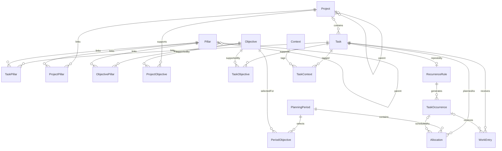

# Preliminary relational model

**Proposal only.** This is a logical schema for discussion, not executable DDL or
an instruction to create all tables in the first release. Columns and states below
remain subject to the review decisions in Requirements.md. Table names use
PascalCase and column names camelCase; no SQL snake_case exception is assumed.

## Domain relationships

Pillar and project parent pointers form separate trees; cross-links do not combine
these trees. Objectives start flat. A project supports zero or more objectives;
a task can directly support objectives even without a project. Pillar navigation
includes explicitly linked entities and visible descendants/inherited paths,
deduplicated. Direct links stay distinguishable from derived associations.

## Shared conventions

- Every domain table, including link tables, has a stable `id` UUID and `datasetId`.
  UUIDv4 is proposed. Link IDs allow their removals to be synchronized as tombstones.
- Unless listed as local-only, rows have `createdAt`, `updatedAt` (UTC instants),
  `deletedAt` (nullable UTC tombstone), and `localRevision` (local counter). Reserve
  nullable `serverRevision` for later sync; timestamps are audit data, not conflict order.
- UUIDs are proposed canonical CHAR(36) in MariaDB and text in mobile SQLite. Domain
  dates use ISO `YYYY-MM-DD`; UTC instants use a fixed canonical representation.
  Store named IANA time zones where calendar semantics require them. Booleans and
  controlled string values receive explicit constraints; do not depend on SQL enums.
- Every foreign key must target the same dataset, preferably using composite
  `(datasetId, referencedId)` foreign keys to unique `(datasetId, id)` targets.
  Logical uniqueness applies to live rows; tombstone restoration rules must be
  explicit. Proposed nullable fields are identified with `?` below.
- Prefer archive for historical entities. Soft deletion preserves history; no
  cascading physical deletion of work, allocations, or relationships during sync.
  Tombstone dependent links in the same logical delete operation. Physical purge
  is a later policy, not a UI delete behavior.

## Organization and task tables

Shared columns above are omitted from this table.

| Table | Proposed additional columns | Relationships / constraints |
| --- | --- | --- |
| Dataset | name, timeZone | Local dataset root, available without login; later mapped to authenticated server ownership. |
| Pillar | parentPillarId?, name, description, archivedAt? | Self FK; reject self-parenting and cycles; no arbitrary depth cap. |
| Objective | title, description, lifecycleStatus, targetStartDate?, targetEndDate?, completedAt?, archivedAt? | Proposed active/onHold/completed/cancelled; date range valid when provided. No period ownership. |
| Project | parentProjectId?, title, description, lifecycleStatus, archivedAt? | Self FK; acyclic tree; project completion rules independent of child completion pending review. |
| Task | projectId?, title, notes, taskKind, lifecycleStatus, triageStatus, planningVisibility, dueDate?, estimatedMinutes?, completedAt?, archivedAt?, captureSource?, captureReference? | kind oneTime/continuing/recurring; proposed lifecycle active/onHold/completed/cancelled; triage inbox/organized; visibility normal/someday; estimate nonnegative. Source metadata optional, provider-neutral. |
| TaskPillar | taskId, pillarId | Unique live pair; explicit association. |
| ProjectPillar | projectId, pillarId | Unique live pair. |
| ObjectivePillar | objectiveId, pillarId | Unique live pair; UI can require a pillar when organizing an objective. |
| TaskObjective | taskId, objectiveId | Unique live pair. |
| ProjectObjective | projectId, objectiveId | Unique live pair. |
| Context | name, description, archivedAt? | User-defined; decide case-insensitive name uniqueness later. |
| TaskContext | taskId, contextId | Unique live pair; contexts may overlap. |
| TaskDependency | predecessorTaskId, successorTaskId, dependencyKind | Unique live directed pair/kind; proposed kind finishToStart; reject self-links and directed cycles. |
| TaskRelation | firstTaskId, secondTaskId, relationKind | Non-blocking related links; canonical endpoint order for symmetric kinds; no self-links. |

A task is unallocated when no applicable live allocation exists; it is not a task
status. Inbox tasks can already have dates, and someday tasks can be explicitly
scheduled. Default planning queries hide someday/archive but permit including them.
Completing a project/objective must never silently complete its tasks or other goals.

Next-action query proposal: active, non-archived, organized work whose blocking
predecessors are complete. An empty project can expose a “needs next action” hint;
it does not invent tasks. Cancelled predecessors should require explicit dependency
review rather than count as completed. Recurring dependencies require a separate
occurrence-matching policy; initially reject blocking links involving recurring
templates rather than implying the entire series can finish each day. Such work
can still have non-blocking related links.

## Planning, allocation, and actual work

| Table | Proposed additional columns | Relationships / constraints |
| --- | --- | --- |
| PlanningPeriod | horizon, startDate, endDateExclusive, label, timeZone | horizon quarter/sprint/week/day; start < end; day exactly one local calendar date. Proposed unique live horizon/bounds within dataset, one timeline per horizon initially. |
| PeriodObjective | periodId, objectiveId, priorityLabel?, manualOrder? | Unique live period/objective; selection has no effect on objective lifecycle; priority label vocabulary undecided. |
| Allocation | taskId, occurrenceId?, periodId, allocationStatus, priorityLabel?, manualOrder?, plannedMinutes?, replacesAllocationId? | Status planned/doneForPeriod/cancelled/rescheduled; minutes nonnegative. For recurring work occurrenceId required; otherwise null. Same-task occurrence FK required. |
| WorkEntry | taskId, occurrenceId?, allocationId?, workDate, timeZone, recordedAt, startedAt?, endedAt?, durationMinutes?, note, outcome, voidedAt? | outcome progress/doneForToday/completed; timestamps/duration optional and validated; linked allocation must target same task/occurrence. Corrections preserve original via void/new entry. |
| PlanningSession | periodId, wizardKind, currentStep, sessionStatus, startedAt, finishedAt?, draftVersion, draftData | Resumable draft/finished/abandoned; draftData is versioned draft intent, not authoritative domain state. Device-local initially; exclude from domain sync until cross-device session requirements are known. |
| PlanningPreference | sprintIntervalUnit, sprintIntervalCount, sprintAnchorDate, weekStartsOn, calendarTimeZone, defaultDailyCapacityMinutes? | One live row per dataset; defaults proposed month/1 with calendar-month anchor. Preference changes affect new periods only. |
| ProtectedDayPreference | weekday, timeZone, advisoryCapacityMinutes?, note, enabled | Advisory only. |
| ProtectedDayPillar | preferenceId, pillarId | Unique live pair; expresses preferred responsibilities, not access rules. |

An allocation references one concrete PlanningPeriod; a daily period supplies the
planned date. A task can have quarterly and sprint commitments and several daily
allocations without changing its lifecycle. For each task/occurrence and period,
propose at most one live non-cancelled/non-rescheduled allocation. A partial unique
index needs separate null/non-null occurrence cases in SQLite. MariaDB needs a
dialect-specific equivalent, such as an indexed generated live-target key: normal
work uses a reserved sentinel instead of nullable occurrenceId, and inactive rows
yield NULL so their history does not prevent a new live allocation. Do not rely on
nullable unique keys alone for normal tasks. Validate the design on the chosen
MariaDB version before implementing it. This permits daily
sessions on multiple days; multiple actual sessions on one day are WorkEntry rows.
If timed multi-slot scheduling is later needed, add session slots rather than
changing this commitment uniqueness implicitly.

Period membership expresses intent; it is not an extra estimate to add to daily
capacity. Capacity counts planned minutes in daily allocations once, with unknown
estimates shown as unknown; broad period commitments are reviewed separately.
Daily views include planned work plus unfinished allocations on past dates, clearly
labeled with their original dates. Completion and doneForPeriod outcomes remain
queryable as history. Default daily presentation groups continuing work already
Done for Today separately so it does not keep appearing as unfinished that day.

Keep optional `priorityLabel` and `manualOrder` separate from due dates and lifecycle.
The first UI can offer manual ordering without a global numeric score. A deterministic
ID tiebreaker stabilizes equal order values. Reordering a list is one logical command;
simultaneous reorders need conflict review. Exact priority/order precedence and rank
encoding are deferred; these nullable fields do not prescribe a scoring algorithm.

## Recurrence

| Table | Proposed additional columns | Relationships / constraints |
| --- | --- | --- |
| RecurrenceRule | taskId, ruleVersion, ruleDefinition, timeZone, startDate, endDate?, enabled | Unique live task/ruleVersion; only recurring templates; versioned structured rule, not provider-specific text. Store old versions for historical occurrences. |
| TaskOccurrence | taskId, recurrenceRuleId, occurrenceKey, nominalDate, lifecycleStatus, completedAt?, overrideTitle?, overrideDueDate? | Same-task rule FK; proposed active/completed/skipped/cancelled; unique dataset/task/occurrenceKey across replicas; per-instance completion. |

Rule definitions need an explicit supported subset (daily/selected weekdays/monthly
first), including interval, month-end behavior, exclusions, and date boundaries.
An RFC-style rule format is an option, not a commitment to implement every RRULE.
Completion-relative repetition is a later distinct mode, not a calendar rule hack.

`occurrenceKey` is the stable series-version + nominal slot identity, unaffected by
rescheduling. A later implementation must give that identity the same record ID on
all devices (for example, a specified namespace UUID derived from it), or canonicalize
duplicate generated rows atomically with their links. Random IDs plus a server
unique constraint alone would not reconcile independently generated offline work.
Prefer deterministic occurrence IDs as a narrow exception to general UUIDv4.
Generate a bounded rolling window, not an infinite series; generation must be
idempotent. Rule edits apply prospectively with an explicit effective boundary and
keep existing completed/overridden occurrences. Review handling of already generated
future unfinished instances before implementing “this and future” edits.

The Task row is the recurring template: its lifecycle controls the series. Completing
an occurrence does not complete the template. Cancelling/archiving a template does
not erase occurrence/work history. A missed occurrence stays on its nominal or
explicitly scheduled date until the user skips, completes, or reschedules it.

## Operation examples and invariants

- **Capture:** insert active Task with inbox triage and no required project/pillar/
  allocation. Voice recognition supplies editable text and optional generic source
  reference; no speech vendor belongs in the relational core.
- **Done for Today:** in one transaction insert WorkEntry, mark today's allocation
  doneForPeriod (creating a daily allocation if needed), leave continuing Task active.
  A stable operation ID prevents accidental double submission. More work can be
  recorded; returning the item to today's active list is an explicit reopen command.
- **Complete one-time task:** mark Task completed with completedAt, insert completion
  WorkEntry, and close outstanding planned allocations atomically. Keep old rows;
  reopening is explicit and does not silently reopen every old commitment.
- **Complete recurrence:** complete TaskOccurrence and its outstanding allocations,
  insert WorkEntry against that occurrence; leave recurring Task active.
- **Reschedule:** set old allocation rescheduled and create target allocation with
  replacesAllocationId in one transaction. Reuse/merge an existing target commitment
  explicitly to honor uniqueness. Undo is a new operation, not history deletion.
- **Sprint review:** PeriodObjective selects existing objectives. Ending the period
  does not complete them, move allocations, or finish tasks.
- **Tree moves:** reject cycles in a transactional application operation. A self FK
  alone cannot enforce acyclicity; concurrent moves need server-side revalidation.

Task completion and WorkEntry outcome must be coordinated by commands rather than
independent UI row edits. Void/correction semantics must not accidentally reopen
completed work. Due dates never automatically generate or move allocations.
Date-only planning remains on its chosen calendar date when traveling; actual UTC
work instants remain unchanged. Review which home/travel zone generates “today”
and recurring dates before mobile implementation.

## Persistence and synchronization support

These are infrastructure records, not user-facing domain entities. Add only what
is needed in each phase; reserve the domain identities/transaction seams early.

| Table | Phase | Proposed fields / role |
| --- | --- | --- |
| SchemaMigration | First persistence slice | version, checksum, appliedAt; local database evolution, no sync. |
| LocalChange | First mutation slice, dormant outbox | operationId, datasetId, entityType, entityId, localRevision, baseServerRevision?, operationKind, payloadVersion, immutablePayload, createdAt, acknowledgmentState; transactionally tied to domain changes; multiple rows grouped by operationId for atomic commands. |
| DeviceState | Sync phase | deviceId, datasetId, serverEndpoint, pullCursor?, lastSuccessAt?; device-local state, not replicated. |
| SyncConflict | Sync phase | id, datasetId, operationId, entityId, baseSnapshot?, localSnapshot, remoteSnapshot, remoteRevision, resolutionState; durable unsent work and conflict review. |
| OperationReceipt | Server sync phase | authenticated scope, operationId, payloadDigest, acceptedResult; unique scope/operation; committed with writes. |
| ServerChange | Server sync phase | ordered cursor/sequence, datasetId, transactionGroup, entityType, entityId, serverRevision, payload/tombstone; supports ordered pull/bootstrap retention. |

Row tombstones carry deletion history; they are not an extra lifecycle status.
Outbox acknowledgment never deletes newer local revisions. Sync applies incoming
changes without creating outbound echoes. Central server and client infrastructure
schemas differ; do not replicate migration or device-state records as domain rows.

Proposed indexes: parent pointers; all association endpoints; task lifecycle/project/
visibility; allocation period/status and task/occurrence; work target/date; occurrence
natural key; pending outbox order; tombstone retention scans. Daily backlog queries
should use indexed period dates and allocation status. Verify real query plans
before adding closure tables, cached counts, FTS, or denormalized hierarchy paths.

## MariaDB desktop and mobile SQLite mapping

The user's platform clarification makes MariaDB the initial Linux store and a
native iPhone application a confirmed target; Windows builds run on Windows.
The logical domain relationships above are unchanged. MariaDB is also the proposed
Windows and hosted default; SQLite is the proposed embedded mobile replica.

Maintain separate SQL migrations for MariaDB and SQLite behind the same domain
repository contract. Use InnoDB, explicit UTC/date mappings, and consistent string
collations for identifiers. Audit all uniqueness rules involving tombstones and NULL:
SQLite partial indexes do not translate directly to MariaDB. Use explicit checks
and generated/indexed keys or equivalent transactionally enforced constraints.

PascalCase SQL table names are still proposed, but MariaDB table-name case behavior
can differ between Linux and Windows installations. Resolve server configuration
and dump/restore portability before freezing physical names; if lowercase SQL names
are preferable, discuss that convention exception before introducing it. Do not
silently rename only one platform's schema.

LocalChange must commit with domain changes in a MariaDB transaction on desktop
and a SQLite transaction on mobile. A local MariaDB service is required for desktop
offline use; no remote service is needed. Server receipt/change-log tables remain
deferred until synchronization, and are not the standalone desktop schema. In the
proposed service-host topology, enabling synchronization adds hub metadata to the
host's MariaDB storage and routes host desktop mutations through the service's
validated write path. The phone's SQLite replica exchanges domain changes with
that Linux/Windows service over HTTPS; no extra cloud database is required.

Start with the phase-one subset described in Roadmap.md. No SQL file, migration,
or database has been created in this iteration.
