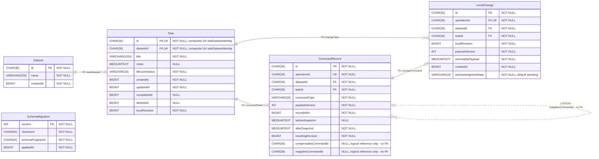

<!-- SPDX-License-Identifier: GPL-3.0-or-later -->

# TaskCompass database schema — Phase 1.1 migration 001

Authority: [001_PersistentTaskFoundation.sql](../../migrations/mariadb/001_PersistentTaskFoundation.sql),
not the preliminary future model. This is the schema defined by migration source;
it is **not evidence of a deployed database or successful live migration**.
Only these five tables exist in this migration. No future pillars, projects,
objectives, contexts, recurrence or planning tables are included.

[Open the standalone SVG](DatabaseSchema.svg) in Firefox; zoom for individual fields.

## Mermaid ER diagram

Legend: **solid lines labeled FK** are actual SQL foreign keys; **dashed lines
labeled LOGICAL/no FK** are intended command-history references with no referential
constraint. The line styles are a documentation convention; the explicit FK labels
and constraint inventory below are authoritative. Each comment explicitly states
NULL/NOT NULL. PK = primary key; FK = foreign-key member; UK = unique-key member.
Task.datasetId and Task.id share **one composite UK**, not two individual uniques.
Parent participation is optional: a parent need not have children.



## Primary and unique constraints

| Table | Primary key | Additional unique constraints |
| --- | --- | --- |
| Dataset | `id` | None |
| Task | `id` | `taskDatasetIdentity(datasetId, id)` |
| CommandRecord | `id` | `UNIQUE(operationId)` (inline) |
| LocalChange | `id` | `UNIQUE(operationId)` (inline) |
| SchemaMigration | `version` | None |

Inline UNIQUE(operationId) is shown without inventing a constraint name; the migration does not
explicitly name those two UNIQUE constraints. PKs themselves are also unique.

## Enforced SQL relationships

| Constraint | Child columns | Referenced columns | SQL cardinality |
| --- | --- | --- | --- |
| `taskDataset` | `Task(datasetId)` | `Dataset(id)` | Each child has exactly one parent; parent has zero or many children |
| `commandTask` | `CommandRecord(datasetId, taskId)` | `Task(datasetId, id)` | Each child has exactly one parent; parent has zero or many children |
| `changeTask` | `LocalChange(datasetId, taskId)` | `Task(datasetId, id)` | Each child has exactly one parent; parent has zero or many children |
| `changeCommand` | `LocalChange(operationId)` | `CommandRecord(operationId)` | Each child has exactly one parent; parent has zero or one child |

All FK columns are NOT NULL. No explicit ON DELETE/ON UPDATE actions are declared;
there is no declared cascading delete/update. SchemaMigration is disconnected.
CommandRecord and LocalChange reach Dataset transitively through their composite
Task foreign keys; neither declares a separate datasetId → Dataset FK.

## Logical references and limits of enforcement

| Logical reference | Nullability | SQL enforcement |
| --- | --- | --- |
| CommandRecord.compensatesCommandId → CommandRecord.id | Nullable | No FK or uniqueness constraint; intended zero/one target per receipt, potentially many receipts per target. |
| CommandRecord.reappliesCommandId → CommandRecord.id | Nullable | No FK or uniqueness constraint; same intended cardinality. |

Dashed self-links describe intended meaning, **not guarantees** that the referenced
row exists, belongs to the same dataset, has a compatible command type or precedes
the referring command. No FK is declared on LocalChange.id. Its operationId, rather
than id, is the actual enforced reference to CommandRecord.

The separate changeTask and changeCommand constraints do **not** require a change
and its referenced command to name the same task/dataset; application transactions
coordinate that invariant. SQL permits a command with no LocalChange, even though
the application writes both atomically. JSON validity does not validate snapshot
shape or equality to Task, nor do the constraints enforce revision sequencing.
The singleton Dataset, schema version/checksum interpretation and chronological
history are application/migration-tool rules, not additional SQL relationships.

## CHECK constraints

These expressions are copied exactly from the migration; omitted application rules
are not presented as SQL constraints. UUID regex checks exist only on Dataset.id
and Task.id. Other CHAR(36) fields do not acquire regex checks implicitly.

| Table | Constraint | SQL expression |
| --- | --- | --- |
| Dataset | `datasetIdFormat` | `id REGEXP '^[0-9a-f]{8}-[0-9a-f]{4}-[0-9a-f]{4}-[0-9a-f]{4}-[0-9a-f]{12}$'` |
| Dataset | `datasetCreatedAt` | `createdAt > 0` |
| Task | `taskIdFormat` | `id REGEXP '^[0-9a-f]{8}-[0-9a-f]{4}-[0-9a-f]{4}-[0-9a-f]{4}-[0-9a-f]{12}$'` |
| Task | `taskTitle` | `OCTET_LENGTH(title) BETWEEN 1 AND 1024 AND CHAR_LENGTH(TRIM(title)) > 0` |
| Task | `taskNotes` | `notes IS NULL OR OCTET_LENGTH(notes) <= 65535` |
| Task | `taskLifecycle` | `(lifecycleStatus = 'active' AND completedAt IS NULL) OR (lifecycleStatus = 'completed' AND completedAt IS NOT NULL)` |
| Task | `taskTimes` | `createdAt > 0 AND updatedAt >= createdAt AND (completedAt IS NULL OR completedAt BETWEEN createdAt AND updatedAt) AND (deletedAt IS NULL OR deletedAt BETWEEN createdAt AND updatedAt)` |
| Task | `taskRevision` | `localRevision > 0` |
| CommandRecord | `commandPayload` | `payloadVersion = 1 AND resultingRevision > 0 AND JSON_VALID(afterSnapshot) AND (beforeSnapshot IS NULL OR JSON_VALID(beforeSnapshot))` |
| CommandRecord | `commandKind` | `commandType IN ('create', 'edit', 'complete', 'reopen', 'undo', 'redo')` |
| LocalChange | `changePayload` | `payloadVersion = 1 AND localRevision > 0 AND JSON_VALID(immutablePayload)` |
| LocalChange | `changeState` | `acknowledgmentState = 'pending'` |

`taskLifecycle` enforces completedAt exactly when status is completed. Task timestamps
are checked against createdAt/updatedAt; positive creation time is explicitly checked
only for Dataset and Task. Not every metadata timestamp has a CHECK. JSON fields
remain MEDIUMTEXT with JSON_VALID checks; they are not physical JSON columns.

## Declared indexes and storage

| Table | Non-unique index | Ordered columns |
| --- | --- | --- |
| Task | `taskActive` | `datasetId, deletedAt, lifecycleStatus` |
| CommandRecord | `commandTaskHistory` | `datasetId, taskId, resultingRevision` |
| LocalChange | `changePending` | `datasetId, acknowledgmentState, createdAt` |

Primary/unique indexes are enumerated above. The migration declares no other
non-unique indexes. InnoDB may create supporting indexes for foreign keys (notably
LocalChange.datasetId/taskId); engine-generated names are not asserted as explicit
migration declarations or verified live artifacts.

Every table uses InnoDB and default utf8mb4/utf8mb4_unicode_ci. Explicit CHAR identity,
checksum and fingerprint columns use ascii/ascii_bin; lifecycleStatus, commandType
and acknowledgmentState are also ascii/ascii_bin. Integer timestamps are BIGINT
UTC epoch milliseconds by application convention, not SQL DATETIME types.
LocalChange.acknowledgmentState has the sole explicit column default: 'pending'.
Every other column requires a value or permits NULL as shown; no AUTO_INCREMENT.

## Regeneration and validation

Generated directly from migration 001 by [GenerateDatabaseSchema.py](GenerateDatabaseSchema.py).
The helper reads repository schema/config files and invokes the local renderer;
it never connects to MariaDB. It is a narrow
reader for this migration's CREATE TABLE syntax, not a general migration interpreter.
When subsequent migrations change the cumulative schema, extend/review the helper
and update both artifacts against the resulting actual DDL. Do not substitute the
future logical model. Both diagrams share the same parsed table/column/key metadata.

```bash
python3 docs/diagrams/GenerateDatabaseSchema.py
python3 docs/diagrams/GenerateDatabaseSchema.py --check
```

Dependencies: Python 3.9+ standard library, Mermaid CLI (`mmdc`) and its browser.
Mermaid CLI 12.2.0 is now installed and has successfully rendered this ER source.
The SVG is a **native Mermaid export**, replacing the earlier Graphviz fallback.
[MermaidConfig.json](MermaidConfig.json) selects a landscape layout, neutral theme,
explicit font/spacing and deterministic IDs. Both logical self-references are
rendered separately. The helper adds provenance metadata and an 80-pixel outer
viewBox margin to prevent CLI 12.2.0 from clipping upper self-reference labels;
it does not change Mermaid's table/connector layout. No software was installed by
the agent.

`--check` does not launch a browser: it verifies SQL/Markdown agreement, embedded
SQL/Mermaid/config provenance, all SVG table fields/types/keys/nullability, four
solid FK links, two dashed logical links, landscape orientation and no external
resources or scripts. It does not promise byte-identical exports across renderer
versions. Review regenerated artifacts after tool upgrades.

The SVG uses XHTML `foreignObject` labels supported by Firefox/Chromium. The local
librsvg preview cannot display those labels; use a browser or a Mermaid-generated
PNG for visual review. Disabling HTML labels in CLI 12.2.0 produced clipped/wrapped
text in this ER diagram, so that configuration is deliberately not used. Browser
sandbox restrictions may require an approved unsandboxed tool invocation; do not
add Chromium `--no-sandbox` flags or install software merely to suppress errors.
Headless Firefox opened the final standalone SVG successfully; its screenshot was
visually inspected with all labels and separate logical connectors visible.
Interactive Firefox use has not been tested.

Mermaid source uses standard [ER syntax](https://mermaid.js.org/syntax/entityRelationshipDiagram.html),
with nullability comments rather than relying on recent nullable-type syntax.

Migration SHA-256: `bb901d7580398893b5c04ee263f813b9d05873eb4bae08e0daf377faf73b0ea0`.
