<!-- SPDX-License-Identifier: GPL-3.0-or-later -->

# TaskCompass database schema — cumulative migrations 001–002

Authority: [001_PersistentTaskFoundation.sql](../../migrations/mariadb/001_PersistentTaskFoundation.sql)
and [002_OrganizationalManagement.sql](../../migrations/mariadb/002_OrganizationalManagement.sql).
This is the cumulative schema defined by actual migration source, **not evidence
that migration 002 has been executed or accepted on a live database**. Phase 1.1
schema deployment/evidence remains preserved in its milestone.

[Open the standalone SVG](DatabaseSchema.svg) in Firefox; zoom for individual fields.
Solid lines labeled FK represent actual SQL constraints; dashed LOGICAL links are
unenforced references. PK/UK/FK annotate column membership, not individual uniqueness
of composite-key members. NULL/NOT NULL and explicit defaults are included.
Optional FK lines reflect SQL nullability, not permission to violate exclusive
parent/target CHECK constraints. No cascading delete/update actions are declared.

## Mermaid ER diagram

```mermaid
erDiagram
   direction LR
   Dataset {
      CHAR(36) id PK "NOT NULL"
      VARCHAR(255) name "NOT NULL"
      BIGINT createdAt "NOT NULL"
   }
   Pillar {
      CHAR(36) id PK,UK "NOT NULL"
      CHAR(36) datasetId FK,UK "NOT NULL"
      CHAR(36) parentPillarId FK "NULL"
      VARCHAR(1024) name "NOT NULL"
      MEDIUMTEXT description "NULL"
      BIGINT archivedAt "NULL"
      BIGINT createdAt "NOT NULL"
      BIGINT updatedAt "NOT NULL"
      BIGINT deletedAt "NULL"
      BIGINT localRevision "NOT NULL"
   }
   Project {
      CHAR(36) id PK,UK "NOT NULL"
      CHAR(36) datasetId FK,UK "NOT NULL"
      CHAR(36) pillarId FK "NULL"
      CHAR(36) parentProjectId FK "NULL"
      VARCHAR(1024) title "NOT NULL"
      MEDIUMTEXT description "NULL"
      BIGINT archivedAt "NULL"
      BIGINT createdAt "NOT NULL"
      BIGINT updatedAt "NOT NULL"
      BIGINT deletedAt "NULL"
      BIGINT localRevision "NOT NULL"
   }
   Objective {
      CHAR(36) id PK,UK "NOT NULL"
      CHAR(36) datasetId FK,UK "NOT NULL"
      CHAR(36) pillarId FK "NULL"
      CHAR(36) projectId FK "NULL"
      VARCHAR(1024) title "NOT NULL"
      MEDIUMTEXT description "NULL"
      BIGINT archivedAt "NULL"
      BIGINT createdAt "NOT NULL"
      BIGINT updatedAt "NOT NULL"
      BIGINT deletedAt "NULL"
      BIGINT localRevision "NOT NULL"
   }
   Task {
      CHAR(36) id PK,UK "NOT NULL"
      CHAR(36) datasetId FK,UK "NOT NULL"
      VARCHAR(1024) title "NOT NULL"
      MEDIUMTEXT notes "NULL"
      VARCHAR(16) lifecycleStatus "NOT NULL"
      BIGINT createdAt "NOT NULL"
      BIGINT updatedAt "NOT NULL"
      BIGINT completedAt "NULL"
      BIGINT deletedAt "NULL"
      BIGINT localRevision "NOT NULL"
      CHAR(36) objectiveId FK "NULL; default NULL"
      CHAR(36) directProjectId FK "NULL; default NULL"
   }
   CommandRecord {
      CHAR(36) id PK "NOT NULL"
      CHAR(36) operationId UK "NOT NULL"
      CHAR(36) datasetId FK "NOT NULL"
      CHAR(36) taskId FK "NULL"
      VARCHAR(16) commandType "NOT NULL"
      INT payloadVersion "NOT NULL"
      BIGINT recordedAt "NOT NULL"
      MEDIUMTEXT beforeSnapshot "NULL"
      MEDIUMTEXT afterSnapshot "NOT NULL"
      BIGINT resultingRevision "NOT NULL"
      CHAR(36) compensatesCommandId "NULL; logical reference only - no FK"
      CHAR(36) reappliesCommandId "NULL; logical reference only - no FK"
      CHAR(36) pillarId FK "NULL; default NULL"
      CHAR(36) projectId FK "NULL; default NULL"
      CHAR(36) objectiveId FK "NULL; default NULL"
   }
   LocalChange {
      CHAR(36) id PK "NOT NULL"
      CHAR(36) operationId FK,UK "NOT NULL"
      CHAR(36) datasetId FK "NOT NULL"
      CHAR(36) taskId FK "NULL"
      BIGINT localRevision "NOT NULL"
      INT payloadVersion "NOT NULL"
      MEDIUMTEXT immutablePayload "NOT NULL"
      BIGINT createdAt "NOT NULL"
      VARCHAR(16) acknowledgmentState "NOT NULL; default 'pending'"
      CHAR(36) pillarId FK "NULL; default NULL"
      CHAR(36) projectId FK "NULL; default NULL"
      CHAR(36) objectiveId FK "NULL; default NULL"
   }
   SchemaMigration {
      INT version PK "NOT NULL"
      CHAR(64) checksum "NOT NULL"
      CHAR(64) schemaFingerprint "NOT NULL"
      BIGINT appliedAt "NOT NULL"
   }
   MigrationAttempt {
      INT version PK "NOT NULL"
      CHAR(64) checksum "NOT NULL"
      CHAR(64) baselineFingerprint "NOT NULL"
      BIGINT startedAt "NOT NULL"
      BIGINT completedAt "NULL"
      INT lastCompletedStep "NOT NULL"
      VARCHAR(16) attemptState "NOT NULL"
   }
   Dataset ||--o{ Pillar : "FK pillarDataset"
   Pillar o|--o{ Pillar : "FK pillarParentScope"
   Dataset ||--o{ Project : "FK projectDataset"
   Pillar o|--o{ Project : "FK projectPillarScope"
   Project o|--o{ Project : "FK projectParentScope"
   Dataset ||--o{ Objective : "FK objectiveDataset"
   Pillar o|--o{ Objective : "FK objectivePillarScope"
   Project o|--o{ Objective : "FK objectiveProjectScope"
   Dataset ||--o{ Task : "FK taskDataset"
   Objective o|--o{ Task : "FK taskObjectiveScope"
   Project o|--o{ Task : "FK taskDirectProjectScope"
   Task o|--o{ CommandRecord : "FK commandTaskV2"
   Pillar o|--o{ CommandRecord : "FK commandPillarV2"
   Project o|--o{ CommandRecord : "FK commandProjectV2"
   Objective o|--o{ CommandRecord : "FK commandObjectiveV2"
   CommandRecord ||--o| LocalChange : "FK changeCommand"
   Task o|--o{ LocalChange : "FK changeTaskV2"
   Pillar o|--o{ LocalChange : "FK changePillarV2"
   Project o|--o{ LocalChange : "FK changeProjectV2"
   Objective o|--o{ LocalChange : "FK changeObjectiveV2"
   CommandRecord o|..o{ CommandRecord : "LOGICAL compensatesCommandId - no FK"
   CommandRecord o|..o{ CommandRecord : "LOGICAL reappliesCommandId - no FK"
```



## Primary and unique keys

| Table | Primary key | Additional unique keys |
| --- | --- | --- |
| Dataset | `id` | None |
| Pillar | `id` | `pillarDatasetIdentity(datasetId, id)` |
| Project | `id` | `projectDatasetIdentity(datasetId, id)` |
| Objective | `id` | `objectiveDatasetIdentity(datasetId, id)` |
| Task | `id` | `taskDatasetIdentity(datasetId, id)` |
| CommandRecord | `id` | `operationId(operationId)` |
| LocalChange | `id` | `operationId(operationId)` |
| SchemaMigration | `version` | None |
| MigrationAttempt | `version` | None |

Inline operationId UNIQUE constraints are shown using their column name; no explicit SQL constraint name is invented.

## Enforced SQL foreign keys

| Constraint | Child columns | Referenced columns | Child-to-parent participation |
| --- | --- | --- | --- |
| `pillarDataset` | `Pillar(datasetId)` | `Dataset(id)` | Exactly one |
| `pillarParentScope` | `Pillar(datasetId, parentPillarId)` | `Pillar(datasetId, id)` | Zero or one (nullable FK member) |
| `projectDataset` | `Project(datasetId)` | `Dataset(id)` | Exactly one |
| `projectPillarScope` | `Project(datasetId, pillarId)` | `Pillar(datasetId, id)` | Zero or one (nullable FK member) |
| `projectParentScope` | `Project(datasetId, parentProjectId)` | `Project(datasetId, id)` | Zero or one (nullable FK member) |
| `objectiveDataset` | `Objective(datasetId)` | `Dataset(id)` | Exactly one |
| `objectivePillarScope` | `Objective(datasetId, pillarId)` | `Pillar(datasetId, id)` | Zero or one (nullable FK member) |
| `objectiveProjectScope` | `Objective(datasetId, projectId)` | `Project(datasetId, id)` | Zero or one (nullable FK member) |
| `taskDataset` | `Task(datasetId)` | `Dataset(id)` | Exactly one |
| `taskObjectiveScope` | `Task(datasetId, objectiveId)` | `Objective(datasetId, id)` | Zero or one (nullable FK member) |
| `taskDirectProjectScope` | `Task(datasetId, directProjectId)` | `Project(datasetId, id)` | Zero or one (nullable FK member) |
| `commandTaskV2` | `CommandRecord(datasetId, taskId)` | `Task(datasetId, id)` | Zero or one (nullable FK member) |
| `commandPillarV2` | `CommandRecord(datasetId, pillarId)` | `Pillar(datasetId, id)` | Zero or one (nullable FK member) |
| `commandProjectV2` | `CommandRecord(datasetId, projectId)` | `Project(datasetId, id)` | Zero or one (nullable FK member) |
| `commandObjectiveV2` | `CommandRecord(datasetId, objectiveId)` | `Objective(datasetId, id)` | Zero or one (nullable FK member) |
| `changeCommand` | `LocalChange(operationId)` | `CommandRecord(operationId)` | Exactly one |
| `changeTaskV2` | `LocalChange(datasetId, taskId)` | `Task(datasetId, id)` | Zero or one (nullable FK member) |
| `changePillarV2` | `LocalChange(datasetId, pillarId)` | `Pillar(datasetId, id)` | Zero or one (nullable FK member) |
| `changeProjectV2` | `LocalChange(datasetId, projectId)` | `Project(datasetId, id)` | Zero or one (nullable FK member) |
| `changeObjectiveV2` | `LocalChange(datasetId, objectiveId)` | `Objective(datasetId, id)` | Zero or one (nullable FK member) |

A referenced parent may have zero children. Composite (datasetId, id) keys prevent
cross-dataset references. Project/Objective each have exactly one organizational
parent; Task has at most one objective or direct project; CommandRecord/LocalChange
each target exactly one of four entity types. Audit target columns identify the
mutated entity, not redundant task ownership. MigrationAttempt and SchemaMigration
are local metadata with no SQL FK between their version columns.

## Logical references and enforcement limits

CommandRecord.compensatesCommandId/reappliesCommandId are nullable logical references
to CommandRecord.id with no FK/uniqueness guarantee. Each may have many referring
receipts; SQL does not ensure existence, dataset, type or chronological validity.
LocalChange.id has no FK: operationId is its enforced command reference.
The separate target and command FKs do not ensure LocalChange and its command
name the same entity/dataset/revision. Application transactions enforce that and
atomic receipt/change insertion. SQL permits a command with no LocalChange.
Ancestor cycles, live-parent availability, inherited archive, singleton dataset,
revision ordering and snapshot shape/equality are application/migration rules.
JSON_VALID alone checks JSON syntax. Version-1 payloads remain task-only; new
version-2 payloads support four targets. Partial migrations require explicit review.

## CHECK constraints

Expressions below come from cumulative SQL (whitespace normalized), with removed
001 constraints omitted and replacements named explicitly.

| Table | Constraint | SQL expression |
| --- | --- | --- |
| Dataset | `datasetIdFormat` | `id REGEXP '^[0-9a-f]{8}-[0-9a-f]{4}-[0-9a-f]{4}-[0-9a-f]{4}-[0-9a-f]{12}$'` |
| Dataset | `datasetCreatedAt` | `createdAt > 0` |
| Pillar | `pillarIdFormat` | `id REGEXP '^[0-9a-f]{8}-[0-9a-f]{4}-[0-9a-f]{4}-[0-9a-f]{4}-[0-9a-f]{12}$'` |
| Pillar | `pillarName` | `OCTET_LENGTH(name) BETWEEN 1 AND 1024 AND CHAR_LENGTH(TRIM(name)) > 0` |
| Pillar | `pillarDescription` | `description IS NULL OR OCTET_LENGTH(description) <= 65535` |
| Pillar | `pillarNotSelf` | `parentPillarId IS NULL OR parentPillarId <> id` |
| Pillar | `pillarTimes` | `createdAt > 0 AND updatedAt >= createdAt AND (archivedAt IS NULL OR archivedAt BETWEEN createdAt AND updatedAt) AND (deletedAt IS NULL OR deletedAt BETWEEN createdAt AND updatedAt)` |
| Pillar | `pillarRevision` | `localRevision > 0` |
| Project | `projectParentChoice` | `(pillarId IS NOT NULL) + (parentProjectId IS NOT NULL) = 1` |
| Project | `projectNotSelf` | `parentProjectId IS NULL OR parentProjectId <> id` |
| Project | `projectIdFormat` | `id REGEXP '^[0-9a-f]{8}-[0-9a-f]{4}-[0-9a-f]{4}-[0-9a-f]{4}-[0-9a-f]{12}$'` |
| Project | `projectTitle` | `OCTET_LENGTH(title) BETWEEN 1 AND 1024 AND CHAR_LENGTH(TRIM(title)) > 0` |
| Project | `projectDescription` | `description IS NULL OR OCTET_LENGTH(description) <= 65535` |
| Project | `projectTimes` | `createdAt > 0 AND updatedAt >= createdAt AND (archivedAt IS NULL OR archivedAt BETWEEN createdAt AND updatedAt) AND (deletedAt IS NULL OR deletedAt BETWEEN createdAt AND updatedAt)` |
| Project | `projectRevision` | `localRevision > 0` |
| Objective | `objectiveParentChoice` | `(pillarId IS NOT NULL) + (projectId IS NOT NULL) = 1` |
| Objective | `objectiveIdFormat` | `id REGEXP '^[0-9a-f]{8}-[0-9a-f]{4}-[0-9a-f]{4}-[0-9a-f]{4}-[0-9a-f]{12}$'` |
| Objective | `objectiveTitle` | `OCTET_LENGTH(title) BETWEEN 1 AND 1024 AND CHAR_LENGTH(TRIM(title)) > 0` |
| Objective | `objectiveDescription` | `description IS NULL OR OCTET_LENGTH(description) <= 65535` |
| Objective | `objectiveTimes` | `createdAt > 0 AND updatedAt >= createdAt AND (archivedAt IS NULL OR archivedAt BETWEEN createdAt AND updatedAt) AND (deletedAt IS NULL OR deletedAt BETWEEN createdAt AND updatedAt)` |
| Objective | `objectiveRevision` | `localRevision > 0` |
| Task | `taskIdFormat` | `id REGEXP '^[0-9a-f]{8}-[0-9a-f]{4}-[0-9a-f]{4}-[0-9a-f]{4}-[0-9a-f]{12}$'` |
| Task | `taskTitle` | `OCTET_LENGTH(title) BETWEEN 1 AND 1024 AND CHAR_LENGTH(TRIM(title)) > 0` |
| Task | `taskNotes` | `notes IS NULL OR OCTET_LENGTH(notes) <= 65535` |
| Task | `taskLifecycle` | `(lifecycleStatus = 'active' AND completedAt IS NULL) OR (lifecycleStatus = 'completed' AND completedAt IS NOT NULL)` |
| Task | `taskTimes` | `createdAt > 0 AND updatedAt >= createdAt AND (completedAt IS NULL OR completedAt BETWEEN createdAt AND updatedAt) AND (deletedAt IS NULL OR deletedAt BETWEEN createdAt AND updatedAt)` |
| Task | `taskRevision` | `localRevision > 0` |
| Task | `taskOwnerChoice` | `(objectiveId IS NOT NULL) + (directProjectId IS NOT NULL) <= 1` |
| CommandRecord | `commandTargetV2` | `(taskId IS NOT NULL) + (pillarId IS NOT NULL) + (projectId IS NOT NULL) + (objectiveId IS NOT NULL) = 1` |
| CommandRecord | `commandPayloadV2` | `(payloadVersion = 1 AND taskId IS NOT NULL OR payloadVersion = 2) AND resultingRevision > 0 AND JSON_VALID(afterSnapshot) AND (beforeSnapshot IS NULL OR JSON_VALID(beforeSnapshot))` |
| CommandRecord | `commandKindV2` | `commandType IN ('create', 'edit', 'move', 'archive', 'restore', 'complete', 'reopen', 'undo', 'redo')` |
| CommandRecord | `commandLifecycleTargetV2` | `commandType NOT IN ('complete', 'reopen') OR taskId IS NOT NULL` |
| LocalChange | `changeState` | `acknowledgmentState = 'pending'` |
| LocalChange | `changeTargetV2` | `(taskId IS NOT NULL) + (pillarId IS NOT NULL) + (projectId IS NOT NULL) + (objectiveId IS NOT NULL) = 1` |
| LocalChange | `changePayloadV2` | `(payloadVersion = 1 AND taskId IS NOT NULL OR payloadVersion = 2) AND localRevision > 0 AND JSON_VALID(immutablePayload)` |
| MigrationAttempt | `attemptVersion` | `version >= 2` |
| MigrationAttempt | `attemptStep` | `lastCompletedStep >= 1` |
| MigrationAttempt | `attemptStateValue` | `attemptState IN ('running', 'failed', 'completed')` |
| MigrationAttempt | `attemptTimes` | `startedAt > 0 AND ((attemptState = 'completed' AND completedAt IS NOT NULL AND completedAt >= startedAt) OR (attemptState IN ('running', 'failed') AND completedAt IS NULL))` |

## Declared non-unique indexes

| Table | Index | Ordered columns |
| --- | --- | --- |
| Pillar | `pillarParent` | `datasetId, parentPillarId, deletedAt` |
| Project | `projectPillar` | `datasetId, pillarId, deletedAt` |
| Project | `projectParent` | `datasetId, parentProjectId, deletedAt` |
| Objective | `objectivePillar` | `datasetId, pillarId, deletedAt` |
| Objective | `objectiveProject` | `datasetId, projectId, deletedAt` |
| Task | `taskActive` | `datasetId, deletedAt, lifecycleStatus` |
| Task | `taskObjective` | `datasetId, objectiveId, deletedAt` |
| Task | `taskDirectProject` | `datasetId, directProjectId, deletedAt` |
| CommandRecord | `commandTaskHistory` | `datasetId, taskId, resultingRevision` |
| CommandRecord | `commandPillarHistory` | `datasetId, pillarId, resultingRevision` |
| CommandRecord | `commandProjectHistory` | `datasetId, projectId, resultingRevision` |
| CommandRecord | `commandObjectiveHistory` | `datasetId, objectiveId, resultingRevision` |
| LocalChange | `changePending` | `datasetId, acknowledgmentState, createdAt` |
| LocalChange | `changePillar` | `datasetId, pillarId` |
| LocalChange | `changeProject` | `datasetId, projectId` |
| LocalChange | `changeObjective` | `datasetId, objectiveId` |

Primary/unique indexes are listed separately. InnoDB can add supporting FK indexes;
engine-generated index names are not asserted as explicit migration declarations.
All tables use InnoDB and default utf8mb4/utf8mb4_unicode_ci. Identity/checksum/
fingerprint and controlled status strings use explicit ascii/ascii_bin as in source.
BIGINT timestamps are UTC epoch milliseconds by application convention. No physical
SQL JSON columns, AUTO_INCREMENT, organization completion lifecycle, ordering,
contexts, planning or sync tables are introduced. archivedAt is explicit; inherited
archive is derived and never stored on descendants as redundant flags.

## Regeneration and validation

[GenerateDatabaseSchema.py](GenerateDatabaseSchema.py) interprets only the reviewed
CREATE/ALTER subset from the two exact migration files, and fails on unknown syntax
or an additional migration. Extend/review the reader for every later migration;
never substitute the preliminary logical model or assume all SQL is supported.
No database is accessed. Dependencies remain Python 3.9+ standard library and
installed Mermaid CLI/browser for rendering; --check needs no browser.

```bash
python3 docs/diagrams/GenerateDatabaseSchema.py
python3 docs/diagrams/GenerateDatabaseSchema.py --check
```

The SVG is a native Mermaid export with deterministic IDs/provenance and an outer
80-pixel viewBox margin to avoid clipping self-reference labels. It uses XHTML
foreignObject labels supported by Firefox/Chromium; librsvg does not render those
labels correctly. Do not disable browser sandboxing or install dependencies to
work around renderer restrictions without approval. A source schema change is not
live migration approval. Render/visual inspection results are in Phase1.2.md.

Migration SHA-256 values:

- `001_PersistentTaskFoundation.sql`: `bb901d7580398893b5c04ee263f813b9d05873eb4bae08e0daf377faf73b0ea0`
- `002_OrganizationalManagement.sql`: `7de311935843e4fc04cbca74d025d9f38986a4154d70bdd29b35a2820f87b736`
